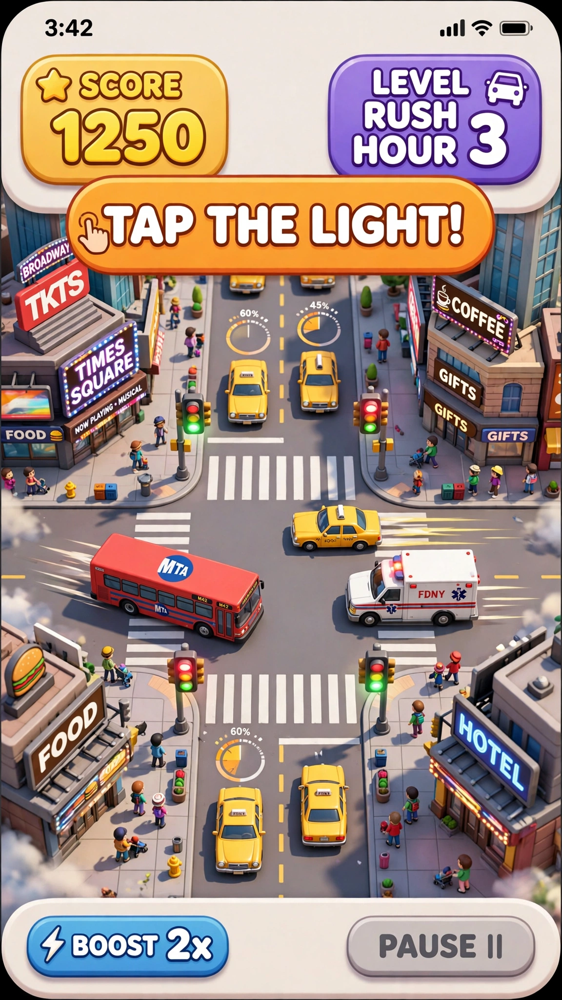
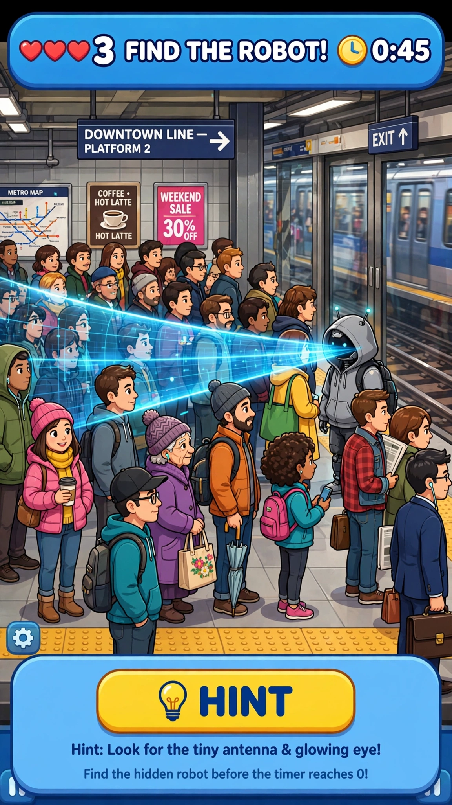
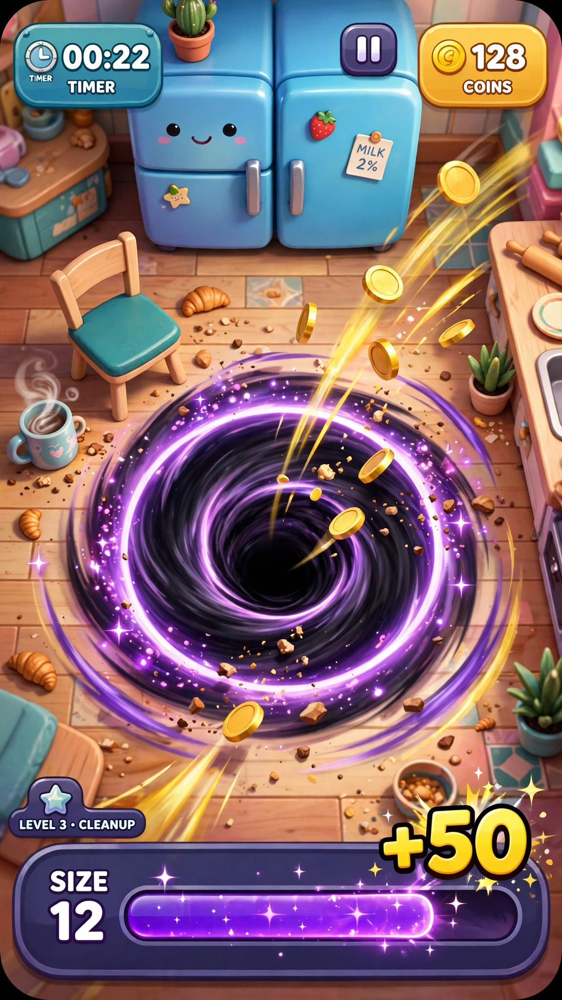

# Análisis de la competencia — YouTube Jugables (Dana Games)

**Fecha:** 15/11/2026. **Autor:** Niky. **Rama:** `niky/analisis-competencia-yt`.
**Origen:** orden de Daniel (15/11 18:40) tras descartar los cinco juegos del día («muy simples, feos, no enganchan, nivel patético»): juegos para YouTube Jugables, analizar la competencia, no ser inferiores, usar toda la potencia de las skills instaladas. Listón reafirmado 18:41: juegos que parezcan que valen 20.000 $ hacerlos. Diagnóstico de Daniel 18:42: «los nuestros son buenas ideas pero malas ejecuciones». Pregunta de Daniel 18:46: «¿cómo conseguimos ser los mejores en videojuegos jugables para YouTube?» («necesitamos ayuda»). Pregunta de Daniel 18:47: ¿podemos hacer juegos como los de la competencia, de plataformas y de estrategia? Alcance precisado 18:48: TODO — diseño, desarrollo, jugabilidad, ingenio.

**Método y límites:** solo fuentes públicas (fichas oficiales de Playgama, ranking público de TubeGames, artículos de Mediacube y Playgama, documentación oficial de Google/YouTube) y auditoría de lo que hay en disco. **No se jugó ninguna partida en vivo** (sin navegador en vivo en esta pasada), así que donde no hay fuente se marca **no observado**: ni duración exacta de nivel, ni cadencia real de anuncios, ni audio oído, ni fluidez medida. Nada de cifras inventadas. Este informe es solo análisis y propuesta: **no se fabrica ningún juego** — por la regla de Daniel, nada se construye sin que él apruebe antes el concepto y el mockup del diseño acabado.

## 0. Conclusión en una frase

El nivel que hay que dar para no ser inferiores es el de los top: que la portada y el primer fotograma enseñen el verbo sin leer, que cada acción tenga un momento de satisfacción grande y visible, que el juego se entienda en 10 segundos con un dedo, y que la diversión esté verificada por humanos antes de que Daniel pruebe nada.

## 1. YouTube Playables hoy (15/11/2026)

**Qué es:** juegos HTML5 jugables dentro de YouTube (app y web), sin instalar nada, gratis para el jugador. Estante «Playables» en la Home, menú Explore → Playables, `youtube.com/playables`, búsqueda y pestaña «You». Progreso guardado y sincronizado por cuenta. **España está cubierta** (ayuda oficial y página de desarrolladores, nov 2026). Requisitos de dispositivo: Android app YouTube 20.46+, iOS 20.44+, escritorio Chrome/Safari/Firefox.

**Escala (trackers independientes, no cifras oficiales de Google):** TubeGames 15/11/2026: **2.367 juegos, 5,91B plays combinadas, +19,1M plays en las últimas 24 h**. Playables.online (oct 2026): 2.670+ juegos, 5,96B plays. Entre el 01/07 y el 04/09/2026 el catálogo casi se duplicó (788 → 1.477 títulos; +1.000M plays en 65 días, Mediacube).

**Géneros por plays (TubeGames, 15/11/2026):** Simulation 333 juegos / 1,4B plays (~24 %), Brain & Puzzle 748 / 1,3B (~22 %), Action 278 / 1,0B (~17 %), Arcade 514 / 832M (~14 %), Racing 151 / 805M (~14 %), Sports 92 / 146M, Multiplayer 9 / 96M, Board & Card 115 / 93M, Trivia & Word 49 / 63M, **RPG & Strategy 61 / 57M (~1,0 %)**, Music 17 / 38M.

**Requisitos técnicos (certificación oficial de Google, actualizada 20/08/2025):**

| Requisito | Límite oficial |
|---|---|
| Bundle inicial (hasta `gameReady`) | MUST < 30 MiB; SHOULD < 15 MiB (después de compresión HTTP) |
| Bundle total | MUST < 250 MiB (excepción con lazy-load) |
| Cada archivo individual | MUST < 30 MiB; SHOULD < 512 KiB |
| Nº total de archivos | Máximo 8.000 |
| Guardado | MUST < 3 MiB; SHOULD < 500 KiB |
| Tiempo a interactivo | SHOULD < 5 segundos |
| Memoria JS (heap) | MUST NOT superar 512 MB de pico |
| Estabilidad | MUST NOT tener crashes reproducibles |

**SDK oficial: sí, hay que usarlo.** YouTube Playables SDK (objeto global `ytgame`), cargado antes de cualquier código del juego (`https://www.youtube.com/game_api/v1`, `index.html` en la raíz). Integraciones requeridas: `ytgame.game.firstFrameReady()`, `ytgame.game.gameReady()`, `ytgame.system.isAudioEnabled()`. Guardado y puntuación: `saveData` / `loadData`, `sendScore`. Motores citados por Google como ya usados: Phaser, Unity (WebGL), Godot, Defold, Cocos, Construct, BabylonJS, PixiJS, PlayCanvas, three.js, Flutter, melonJS, React. **Nuestro stack (Phaser 3 + TS + Vite) es válido.**

**Más reglas:** funcionar en **todos los aspect ratios** (1:1, 16:9, 9:16), responder a resize, sobrevivir a viewport de tamaño cero; táctil **y** ratón en todas las interacciones; inglés obligatorio y leer el idioma con `getLanguage` del SDK; prohibidas llamadas externas (salvo APIs de Google/YouTube), login screens, recogida de datos, QR, enlaces externos, prompts de compartir y botón de salir; código no ofuscado (minificación sí); single-page app; contenido original (política de duplicados, 25/08/2026); etiquetas de accesibilidad (24, desde 02/11/2026); audiencia general (13+).

**Envío / admisión:** acceso en **early access por invitación** — se rellena el *Playables interest form* de Google. Prerrequisito: permiso de *channel manager* en un canal de YouTube *onboarded* (Editor o Manager en YouTube Studio → Settings → Permissions). El Developer Portal guía en 4 pasos: **Details → Test → Age rating → Review & publish** (ZIP con entry point, metadatos, miniatura por ratio, idioma, monetización; enlaces de prueba Dev Link y Test Suite; probar en desktop web, mobile web, Android e iOS; **rating IARC obligatorio** antes de enviar; máx. **10 juegos en revisión a la vez** por canal). Resultados: *Ready to publish*, *Ready to publish, changes recommended* o *Changes needed*. **Google no publica plazo de revisión** (no verificado oficialmente; terceros: revisión 3–7 días, total 2–4 semanas vía publisher). Vía publisher (Playgama, Mediacube): publican con su acceso y SDK; Playgama afirma reparto 75 % desarrollador / 25 % Playgama y no exclusividad.

**Monetización:** piloto de *revenue sharing* por anuncios (pre-roll automático — no se puede apagar —, interstitial con `ytgame.ads.requestInterstitialAd()` en pausas lógicas, rewarded con `ytgame.ads.requestRewardedAd(id)` opt-in). **No hay porcentaje de reparto oficial publicado por Google** (solo «piloto»); el «55/45» que circula no está verificado. Playgama afirma que sus títulos más fuertes ganaron 10.000–15.000 $ en su primer mes (afirmación de marketing, **no verificada**). Mediacube (en el piloto desde abril 2026): rewarded = mayor engagement y CPM; fill aún no del 100 %; geografía = mayor factor de CPM; sesión 10+ minutos manda. **Implicación para la meta de 2.500 €/mes: no hay camino garantizado** — depende de (a) entrar en early access, (b) pasar certificación, (c) entrar en el piloto de revenue sharing o publicar vía publisher que ya esté en él, y (d) volumen + retención + geografía.

**Mecánicas que más escalan en 2026 (Mediacube, estrenos 1/7–4/9/2026, plays/día):** 1) Draw & Escape Puzzle (Tricky Twist 394K/día), 2) Car Physics & Crash Sandbox (Crazy Flying Car 365K/día), 3) Store & Tycoon Simulation (Hypermarket 3D 286K/día), 4) Beauty & Fashion Casual (Hair Salon 266K/día), 5) Ragdoll & Action Shooter (Ragdoll Gun Shooter! 306K/día), 6) Arcade Racing & Obstacle Course (Racing Limits 282K/día). Patrón común: **mecánica de un dedo, onboarding ≤10 segundos, feedback instantáneo, sin tutorial**. Peor: RPG, estrategia y multijugador con tutorial >30 s.

## 2. Teardown: 11 juegos top de YouTube Jugables

Tres tandas: la previa (15/11, `kit/teardowns-competencia.md`: Piece of Cake, Arrow Puzzle, Coin Run), la 2ª tanda (Epic Sword, Tricky Twist, Draw Crash Race, Camo Sniper 3D, Slope 3D, Crime and Vice City Police) y esta tanda (Bridge Race — plataformas — y Cup Heroes — estrategia —, por la pregunta de Daniel 18:47). Total: **11 juegos**. Eje: dimensiones de **EJECUCIÓN** (arte, feel/juice, onboarding, pulido, rendimiento, sonido), no la idea.

| Juego | Plays (Playables) | Verbo único | Gancho 10 s | Arte (acabado) | Meta (por qué vuelves) | Sesión |
|---|---|---|---|---|---|---|
| **Tall Man Run** (Supersonic) | ~113M (#1) | Correr y crecer | Creces al instante | 3D runner colorido | Crecer + skins | Runs cortas |
| **Build a Queen** (Supersonic) | ~109M (#2) | Correr y construir | Tu cuerpo cambia | 3D runner | Reina más grande | Runs cortas |
| **Snake Clash!** (Supercent) | ~107M (#3) | Comer y crecer | Comes al instante | Arena con gusanos | Ser el más grande | Runs cortas |
| **Epic Sword Battle!** (Eccentric) | ~28M (#1 Playgama) | Deslizar = golpear | El primer muñeco vuela | 3D arena; el ragdoll es el feedback | Espadas, niveles, leaderboard | 2–5 min |
| **Piece of Cake** (Happy Games) | n.º 1 trending Playgama | Combinar ingredientes | Limpiar brillo / comida | 3D chicle pulido | Restaurar 21 locales | Gestión troceada |
| **Arrow Puzzle** (Green Train) | n.º 2 trending Playgama | Tocar la flecha libre | La portada ya enseña la regla | Limpísimo, una flecha azul | Diario + leaderboard + vidas | Niveles cortos |
| **Coin Run** (Thriller) | 22M (5.º Playgama) | Pasar por la puerta verde | Verde suma / rojo resta | 3D saturado, dinero como personaje | Negocios e imperio | Runs + tycoon |
| **Tricky Twist** (Bazooka) | ~10M; 394K/día | Tocar lo inesperado | El primer acertijo te engaña | Viñeta de dibujo por nivel | Completar 200+ acertijos | Un acertijo = segundos |
| **Draw Crash Race** (Melnikov) | 2,5M; 968K en 7 días | Dibujar tu coche | Dibujas antes de correr | 3D limpio; tu dibujo es el prota | Monedas → durabilidad/velocidad/tinta | 2–4 min |
| **Camo Sniper 3D** (Arc9) | 2,5M; 1,2M en 7 días | Encontrar y disparar | «¿Dónde está escondido?» | 3D saturado; el color es la mecánica | Niveles + monedas | 2–5 min |
| **Slope 3D** (Cursora Labs) | ~1M; 503K en 7 días | Esquivar izq/der | La bola ya rueda | Neón minimalista; contraste total | Récord + leaderboard + bolas | Runs de segundos, reintento inmediato |
| **Crime and Vice City Police** (KreizLand) | 4,9M; 2M en 7 días | Chocar y verlo en cámara lenta | Apareces conduciendo | 3D ciudad; la deformación es el juego | Tuning, coches, multijugador | Sandbox |
| **Bridge Race** (Supersonic/Garawell) | **~71M (#13)** | Correr, recoger, construir | La codicia en el primer viaje | 3D colorido, pilas de bloques | Subir pisos, ganar la carrera | Rondas de 2 min |
| **Cup Heroes** (Voodoo) | **~6,7M (#206)** | Elegir héroe, mejorar, luchar | La primera taza pelea | Tazas con cara y armas | Héroes, equipo, reinos | Runs de minutos + diario |

*Plays: TubeGames, recuentos del 14–15/11/2026. Valoraciones en ficha Playgama: Epic Sword 4,7/1.794; Piece of Cake 4,5/6.181; Arrow Puzzle 4,6/1.984; Coin Run 4,6/325; Draw Crash Race 4,5/405; Camo Sniper 4,4/94; Crime 4,7/1.566; Bridge Race 4,5★ App Store (1.050.453 ratings) y 8,7/10 CrazyGames; Cup Heroes 4,5★ App Store (87.607) y 9,0/10 CrazyGames.*

### 2.1 Bridge Race — plataformas (el plataformas top)

- **Ficha:** https://playgama.com/game/bridge-race — **Estudio:** Supersonic Studios (desarrollado por Garawell). **Género:** plataformas / carrera con construcción. **Publicado:** 2024-09-17. **Plays:** ~71M, n.º 13 de 2.367 (TubeGames, 15/11/2026).
- **Bucle:** corres por un piso, recoges bloques de tu color (se apilan en tu espalda), caminas hasta un hueco y los bloques se colocan uno a uno como puente al siguiente piso. Rivales hacen lo mismo a la vez. Puertas multiplicadoras (x2) o que quitan bloques, toboganes, ascensores y tirolinas como atajos.
- **Ejecución, dimensión por dimensión:**
  - **Arte:** 3D colorido y limpio; la pila de bloques en la espalda *es* el estado del jugador (se ve cuánto llevas sin mirar ningún HUD). Un color por corredor, legible a distancia.
  - **Feel/juice:** el juice es la **decisión con coste**: una pila grande te hace lento y un golpe te la tira toda al suelo. Cada viaje es codicia contra velocidad. Las puertas x2 son el momento de «¿me la juego?».
  - **Onboarding (10 s):** arrastrar para moverte; recoges bloques solo por pasar encima; el puente se construye solo por caminar. Cero texto: la primera ronda ya es el tutorial. «Bright, wordless» (TubeGames).
  - **Pulido:** rondas de un par de minutos, reintento instantáneo, progreso guardado por YouTube. Pistas integradas: el propio diseño te enseña (viajes cortos, no un gran acarreo).
  - **Rendimiento:** no medido en esta pasada. **Sonido:** no observado.
  - **Debilidades que TubeGames sí vio (y que hay que aprender):** los rivales se comportan como bots, no como personas; los niveles se parecen mucho tras los primeros; en móvil el pulgar tapa los grupos de bloques y se fallan huecos en el suelo. **Incluso el n.º 13 tiene defectos — la diferencia es que su verbo y su juice tapan los defectos.**
- **Qué lo hace adictivo (una frase):** cada viaje es una apuesta — ¿cargo más y voy lento, o voy ligero y vuelvo antes?

### 2.2 Cup Heroes — estrategia (la estrategia top)

- **Ficha:** https://playables.games/games/cup-heroes/ — **Estudio:** Voodoo. **Género:** RPG ligero / estrategia ligera de escuadrón. **Publicado:** 2025-09-09. **Plays:** ~6,7M, n.º 206 de 2.367 (TubeGames, 15/11/2026). **Género RPG & Strategy en total: 61 juegos, 57M plays (~1 % del catálogo).**
- **Bucle:** eliges un héroe (Knight Cup, Ninja Cup…), pasas niveles cortos contra jefes y minions, cada run deja caer monedas, gemas y equipo, y eso alimenta la siguiente run. Reinos (bosque, volcán, mazmorra), recompensas diarias, eventos.
- **Ejecución, dimensión por dimensión:**
  - **Arte:** tazas con cara y armas — la idea absurda es el gancho visual. Cada héroe se juega distinto, no es solo un skin.
  - **Feel/juice:** la recompensa es el *drop* de cada run: «cada run deja algo, y ese algo alimenta la siguiente». El progreso se ve en el héroe (nivel, equipo), no en un número abstracto.
  - **Onboarding (10 s):** swipe/tap para mover y confirmar; la primera run es el tutorial. La estrategia está en la **pantalla de mejoras**, no en el combate: las peleas se resuelven con tu build, no con tus reflejos.
  - **Pulido:** diario antes que nada (la recompensa diaria es «el poder más barato del juego»), eventos por tiempo limitado, guardado por YouTube.
  - **Rendimiento:** no medido. **Sonido:** no observado.
  - **Debilidades (TubeGames):** el grind se nota cuando los números enemigos suben; los combates son «build-first, hands-second»; la historia es una excusa. **La estrategia que funciona en Playables es ligera: presentación tonta, decisiones de un toque, runs de minutos.**
- **Qué lo hace adictivo (una frase):** cada run te deja algo que hace más fuerte a tu taza, y quieres ver qué deja la siguiente.

### 2.3 Lecciones de EJECUCIÓN (lo que separa a estos 11 de los nuestros)

1. **El arte no decora: es la mecánica.** En Camo Sniper el color *es* el puzle; en Draw Crash Race tu dibujo *es* el coche; en Crime la deformación *es* la recompensa; en Bridge Race la pila de bloques *es* tu estado. Nuestros cinco descartados eran «simples y feos» porque el arte era un envoltorio, no el juego.
2. **El juice es un momento, no un sistema.** Ragdoll al golpear, cámara lenta al acertar o al chocar, «SPEED UP» al acelerar, el «¡ahí está!» al encontrar al camuflado, la pila que se cae al suelo. Un solo momento de satisfacción por acción, grande y visible. Nuestros juegos necesitan ese momento diseñado **antes** que el menú.
3. **Onboarding = 0 segundos de lectura.** Los once empiezan jugando: deslizar, tocar, dibujar, rodar, conducir, arrastrar. Mediacube lo cifra en «mecánica de un dedo, onboarding de diez segundos». Si un juego nuestro necesita explicar algo con texto, la ejecución ya falla.
4. **Pulido se ve en lo que rodea al verbo.** Pistas integradas (Camo, Tricky Twist), mejoras legibles en 3 stats (Draw Crash Race), reintento inmediato con un botón (Slope 3D), monedas visibles tras la victoria (Camo), diario (Cup Heroes). Menús, transiciones y pantallas de resultado son parte del juego, no el envoltorio.
5. **Rendimiento y sonido: lo que no se pudo verificar.** Solo Epic Sword afirma 60 FPS en teléfonos baratos (afirmación del portal, no medición propia) y solo Draw Crash Race menciona el diseño de sonido en su ficha. Todo lo demás es **no observado**. Hace falta partida en vivo con navegador para cubrir estas dos dimensiones antes de copiar nada.
6. **La idea no era el problema.** Los once usan ideas viejísimas (duelos, acertijos, dibujar, esconderse, rodar una bola, chocar coches, correr y construir, tazas que pelean). Lo que escala es la ejecución: arte que es mecánica, un momento de juice por acción, cero lectura, reintento inmediato y un meta que se ve (espadas, locales, negocios, récord, héroes).

## 3. Comparación: ellos vs nosotros, dimensión por dimensión de EJECUCIÓN

Lo que Daniel vio en YouTube («alucino») es ejecución, no ideas. La tabla compara lo que hacen los 11 top con lo que falló en nuestros 5 descartados, con la evidencia que la auditoría encontró en disco.

| Dimensión | Lo que hacen ellos (top) | Lo que falló en los nuestros (evidencia en disco) |
|---|---|---|
| **Arte** | El arte *es* la mecánica: el color es el puzle (Camo Sniper), tu dibujo es el coche (Draw Crash Race), la deformación es la recompensa (Crime), la pila de bloques es tu estado (Bridge Race). Portadas que enseñan la regla sin leer. | Arte generado, no dirigido: sin personajes con historia, sin art bible por juego. Estampida: portada con una mano que se lee como peineta; suelo vacío 23 % (800×800) y ~45 % (1080×1920); fondo «más simple que el vagón de Metro» (auditoría r12). Cofre: arte generado sin personajes con historia. Barista: parche de crema pintado en el fondo `map-street.jpg`. |
| **Feel / juice** | Un solo momento grande por acción: ragdoll al golpear, cámara lenta al chocar, «SPEED UP» al acelerar, el «¡ahí está!» al encontrar al camuflado, la pila que se cae al suelo. | Ninguno de los 5 tiene un momento de juice diseñado y verificable. Gummy: «clon directo con arte de patrón repetido», jefe que nunca apareció (`boss:false`). Cofre: una sola acción (tocar) en rondas de 45–60 s. Seagull: una sola mecánica repetida 30 niveles con variación numérica. |
| **Onboarding (10 s)** | Cero lectura: la primera pantalla ya es el juego (deslizar, tocar, dibujar, rodar, conducir, arrastrar). Mediacube: onboarding ≤10 s. | Estampida y Barista: **mismo bug táctil en 2/5** — botones JUGAR/VOLVER solo responden en la mitad superior-izquierda (`Rectangle(-W/2,-H/2,…)`); 44 px de desplazamiento en Barista. El jugador no puede ni empezar bien. |
| **Pulido** | Pistas integradas, mejoras legibles en 3 stats, reintento inmediato, diario, meta visible (espadas, locales, negocios, récord, héroes). | Marketing incompleto en todos: sin portadas/GIF/Short/listing (Barista); niveles 2–30 nunca jugados a mano (Cofre); curva aritmética sin playtest humano más allá del nivel 1 — L26–30 ¿difícil o imposible? (Seagull); r13 sin auditoría propia en disco (Estampida). |
| **Rendimiento** | Solo Epic Sword afirma 60 FPS en teléfonos baratos (afirmación del portal, **no medición propia**). | 6–14 FPS en sandbox (Cofre), 3,6–7,1 FPS en headless (Seagull) — valores de sandbox, no de móvil real, y aun así no se midieron en móvil real antes de entregar. |
| **Sonido** | Solo Draw Crash Race menciona el diseño de sonido en su ficha. El resto: no observado. | Sonido sintetizado sin prueba de escucha (Seagull). Ningún juego nuestro tiene sonido oído y aprobado por un humano. |

**La diferencia en una línea:** ellos diseñan el momento de satisfacción primero y el código después; nosotros escribimos el código primero y el arte después.

## 4. Por qué fallamos (y qué skill cubre cada hueco)

El diagnóstico de Daniel es exacto: **las ideas eran buenas, la ejecución no**. Las 5 ideas descartadas tenían viral 4–5 y género con decenas de millones de plays (Seagull = DOP, Gummy = Snake Clash 107M, Estampida = Arrows ~4M usuarios/día, Cofre = la mejor documentada, 32/35). Falló el proceso:

1. **Arte después del código.** Metro se hizo con 34 personajes diseñados antes de programar; nosotros generamos el arte al final y lo pegamos con chroma. El arte tiene que ser la primera decisión, no la última.
2. **Sin teardown aplicado por juego.** El kit (`kit/teardowns-competencia.md`) ya existía con 3 juegos y sus lecciones — no se usó como checklist de entrada de ningún juego.
3. **Sin aprobación de diseño antes de fabricar.** La regla llegó el 15/11 a las 17:51, después de los 5 juegos. Hasta entonces se fabricaba directo de la idea al código.
4. **Prisa por entregar 5 juegos en un día.** Rondas 7–13 parcheando en vez de reconstruir: Barista sin fuente TS (parche sobre bundle minificado), Gummy sin pack reconstruible (sin `src/`, `package.json`, `dist/`, informe ni skills-usadas en disco — solo logs y capturas).
5. **QA de conformidad, no de diversión.** 35/35 tests (Seagull), 11/11 unitarios + 20/20 smoke + `tsc` 0 (Cofre), 34/34 Vitest (Gummy) — todos descartados por Daniel. **Los tests en verde no predicen el veredicto de Daniel.**
6. **Skills de teoría sin ejecución.** Las 66 cubren la teoría; falta la ejecución concreta (ver §5). La skill `game-juice` ya instalada **exige `gsap-skills` como sub-skill obligatoria** («do NOT hand-roll easing») y hoy **no está instalada**.

### Mapa de huecos → skills instaladas que lo cubren (y no se aplicaron) → skill nueva

| Hueco de calidad | Skill instalada que lo cubre (no aplicada) | Skill nueva de GitHub (§5) |
|---|---|---|
| Arte sin dirección, sin personajes | `art-bible`, `concept-art`, `game-art-bible`, `sprite-sheet`, `character-design`, `key-art` | `agent-sprite-forge` (animación de sprites) |
| Sin juice (sin partículas, sin tween, sin cámara) | `game-feel`, `game-juice`, `animation`, `game-animation`, `camera`, `particle-effects`, `screen-shake`, `vfx` | **GSAP oficial** (`gsap-core`, `gsap-timeline`, `gsap-performance`) — obligatoria para `game-juice`; **Phaser oficial** (`particles`, `tweens`, `animations`, `cameras`) |
| Curva sin jugar, niveles sin playtest | `difficulty-and-balancing`, `level-design`, `game-balancing`, `puzzle-design`, `level-testing`, `playtesting` | **`prototype-fast` + `puzzle`** (prototipo desechable keep/kill/retune; puzzles verificados por solver) + **`game-playtest-squad-skill`** (playtest multi-perfil con evidencia) |
| Onboarding con texto / botones rotos | `game-ui-ux`, `mobile-first`, `ui-ux`, `touch-controls`, `gesture-controls`, `onboarding`, `ftue` | `tutorial-for-game` (FTUE), `game-ui-ux-pro-max` |
| Sonido sintetizado sin escuchar | `audio-design`, `sound-design`, `audio` | **`game-audio`** (Web Audio móvil: desbloqueo en primer gesto, buses, variación, música adaptativa, checklist iOS/Android) |
| Sin prototipo previo (código directo) | `game-design`, `game-design-document`, `prototyping` | **`prototype-fast`** (una pregunta, greybox, playtest, keep/kill/retune) |
| Rendimiento sin medir en móvil real | `performance`, `performance-optimization`, `mobile-optimization`, `phaser-performance` | **Phaser oficial** (`filters`, `audio-and-sound`) + GSAP `gsap-performance` |
| Plataformas sin números de salto | `phaser-core`, `phaser-arcade-physics` (instaladas) | **`platformer`** (awesome-gamedev: coyote time, jump buffer, números de salto) |

**Qué skill faltó aplicar en cada juego descartado:**
- **Seagull:** `difficulty-and-balancing` (curva sin jugar) + `game-audio` (sonido sin escuchar) + `game-playtest-squad-skill` (playtest humano).
- **Gummy:** `prototype-fast` (sin prototipo, clon directo) + `game-feel`/`game-juice` (sin momento de satisfacción) + proceso (pack no reconstruible).
- **Estampida:** `touch-controls` (bug táctil) + `art-bible` (portada con la mano, suelo vacío) + `level-design` (r13 sin auditoría).
- **Barista:** `touch-controls` (mismo bug, 44 px) + `art-bible` (parche de crema) + proceso (sin fuente TS).
- **Cofre:** `game-feel`/`game-juice` (una sola acción, 45–60 s por ronda) + `character-design` (sin personajes con historia) + `difficulty-and-balancing` (niveles 2–30 sin jugar a mano).

## 5. Skills de GitHub: top 5 para instalar (investigación en `~/workspace/dana-games-skills-investigacion-2026-11-15.md`)

Diagnóstico: las 66 cubren la **teoría**; falta la **ejecución concreta**. Instalar de 3 en 3 como mucho, verificando licencia y actividad antes. Nada instalado todavía: solo propuesta.

| # | Skill (repo, licencia) | Qué resuelve | Por qué primero |
|---|---|---|---|
| 1 | **Skills oficiales de Phaser** (phaserjs/phaser, MIT, ~40,6k★): `particles`, `tweens`, `animations`, `audio-and-sound`, `filters`, `cameras` | Juice real en nuestro motor (partículas, tweens, cámaras, filtros) | Dana solo tiene `phaser-core` y `phaser-arcade-physics`. Es la base de todo el juice. |
| 2 | **GSAP oficial** (greensock/gsap-skills, skills MIT, ~18,5k★; librería gratis): `gsap-core`, `gsap-timeline`, `gsap-performance` | Animación de interfaz y juice con rendimiento medido | `game-juice` ya instalada la exige como sub-skill obligatoria y hoy no está. |
| 3 | **`prototype-fast` + `platformer` + `puzzle`** (awesome-gamedev, Apache-2.0, 8.970★) | Prototipo desechable antes de fabricar (keep/kill/retune); números de salto (coyote time, jump buffer); puzzles verificados por solver | Ataca la raíz: fabricábamos sin prototipo y sin verificar si era divertido. |
| 4 | **`game-audio`** (ingenium-plugin) | Web Audio móvil: desbloqueo en primer gesto, buses, variación, música adaptativa, checklist iOS/Android | Mayor hueco de audio: hoy solo `audio-design`, teórico. |
| 5 | **`game-playtest-squad-skill`** (kanoan7643) | Playtest multi-perfil con evidencia + doble informe (`human-report.md` + `ai-fix-packet.md`) | Gate antes de que Daniel pruebe nada: la QA de máquina no predice si engancha. |

Segundos (después de las 5): `tutorial-for-game` (FTUE), `agent-sprite-forge` (animación de sprites), `game-ui-ux-pro-max`, `haptic-rumble`/`juice-vfx` (open-game-skills). Descartados: gamestack (solapa), VibeGame, ForgeSkills (Godot), PixiJS oficial (Dana usa Phaser).

**Regla del manual:** solo las 66 skills de la lista de Grok; si falta alguna necesaria, se instala. Estas 5 son las necesarias. **Alcance de Daniel 18:48 (TODO — diseño, desarrollo, jugabilidad, ingenio):** las 5 cubren las 4 áreas — diseño (Phaser/GSAP/sprites), desarrollo (Phaser/GSAP), jugabilidad (`prototype-fast`, `platformer`, `puzzle`) e ingenio (playtest con evidencia).

## 6. ¿Podemos hacer plataformas y estrategia? (respuesta a Daniel, 15/11 18:47)

**Sí, a los dos. Con matices honestos sobre el alcance.**

### Plataformas — SÍ, y es una apuesta viable

Bridge Race (71M plays, n.º 13) demuestra que el plataformas híbrido (correr + recoger + construir) escala en Playables. Lo que hace falta:

| Qué hace falta | Estado nuestro |
|---|---|
| Tecnología: Phaser 3 + física arcade | **La tenemos** (`phaser-core`, `phaser-arcade-physics` instaladas). |
| Números de salto que se sienten bien (coyote time, jump buffer, gravedad, aceleración) | **Falta la skill `platformer`** (awesome-gamedev) — es la nº 3 del top 5 (§5). |
| Arte 3D/toy con personajes con volumen | **Falta** — es el hueco nº 1 (§4). El arte de plataformas es el que más se nota cuando es flojo. |
| Niveles verificados (que todos se puedan pasar y sean divertidos) | **Falta el proceso** — `prototype-fast` + playtest humano (§5, §7). |
| Tiempo | Un plataformas de un dedo (correr, saltar, recoger, construir) es un ciclo de trabajo, no un mes. Un plataformas 3D con multijugador, no. |

**Alcance realista:** un plataformas de **un dedo** — correr, saltar, recoger, construir — **SÍ está a nuestro alcance con el proceso nuevo**. Un plataformas 3D complejo con multijugador real **NO** (rendimiento, tiempo, arte 3D). Bridge Race mismo tiene los rivales como bots, no como personas — y aun así es el n.º 13.

### Estrategia — SÍ, pero solo LIGERA

Cup Heroes (6,7M plays, n.º 206) demuestra qué estrategia funciona en Playables: **ligera**. Escuadrón, mejoras, decisiones de un toque, runs de minutos. La estrategia profunda **no escala**: el género RPG & Strategy entero es el 1 % de las plays (61 juegos, 57M), y Mediacube marca que lo que falla es el tutorial >30 s.

| Qué hace falta | Estado nuestro |
|---|---|
| Tecnología: Phaser + guardado + economía | **La tenemos** (`phaser-core`, `save-systems`, `difficulty-and-balancing`). |
| Diseño de progresión (números, economía, curva de poder) | **Falta el proceso** — `difficulty-and-balancing` instalada pero no aplicada; `prototype-fast` para verificar la curva jugando. |
| Contenido: muchos héroes, niveles, equipo | **Falta** — es trabajo de contenido, no de código: 3–5 héroes distintos con habilidades reales, no skins. |
| Onboarding sin texto | **Falta** — `tutorial-for-game` (FTUE) como segunda oleada (§5). |

**Alcance realista:** un **«light strategy» de escuadrón** con 3–5 héroes y runs de 2–3 minutos **SÍ**. Un RTS o un 4X **NO** (meses de contenido, tutorial largo, no pasa el onboarding de 10 s de Playables). La vía es Cup Heroes, no un juego de mesa.

## 7. Cómo ser los mejores (respuesta a Daniel, 15/11 18:46)

«¿Cómo conseguimos ser los mejores en crear videojuegos jugables para YouTube?» — el camino, en orden:

**1. Parar de fabricar hasta tener el proceso (esta semana).** Instalar las 5 skills del top 5 (§5), de 3 en 3, verificando licencia y actividad. Fijar el gate de calidad por escrito (abajo). Nada se fabrica mientras tanto: Scribble Striker r2.1 sigue en marcha porque su diseño cómic ya está aprobado por Daniel.

**2. Proceso nuevo por juego (el orden es la lección):**
1. **Teardown del género** — 3 juegos top del género, con la tabla de ejecución (§2). Sin teardown no hay concepto.
2. **Concepto + mockup del diseño acabado** — la pantalla principal completa, fiel a cómo se vería el juego terminado.
3. **Aprobación de Daniel** — si el mockup no le gusta, no se construye. Regla de proceso del 15/11 17:51.
4. **Prototipo desechable** (`prototype-fast`): una pregunta («¿es divertido este verbo?»), greybox, playtest, keep/kill/retune. El prototipo se tira; el aprendizaje queda.
5. **Arte premium completo** — art bible, personajes con historia, key art — antes de programar el juego entero.
6. **Código con juice** — partículas, tweens, cámaras, sonido (Phaser oficial + GSAP + `game-audio`).
7. **Playtest con humanos** (`game-playtest-squad-skill`) — gate antes de que Daniel pruebe nada.
8. **QA técnica** — corners, carga, bundle, FPS en móvil real, sonido oído.
9. **Daniel prueba la versión final** — puerta del 15/11 11:17.
10. **Publicar** — Playgama / YouTube Playables.

**3. Qué mide si vamos bien (métricas, no opiniones):**
- Mockup aprobado a la primera, sin rehacer.
- Prototipo con «¿es divertido?» = sí de 3/3 playtesters humanos.
- 0 defectos táctiles (corners 100 %).
- Carga <5 s, bundle inicial <15 MiB, 60 FPS en móvil real.
- Primera sesión sin leer texto; reintento <2 s tras perder.
- Daniel no descarta.

**4. Ritmo: 1 juego bien hecho por ciclo, no 5 en un día.** Cada ciclo lleva teardown + prototipo + playtest. La velocidad que importa es la de los descartes a cero, no la de los juegos por día.

## 8. Qué ayuda necesitamos (respuesta a «necesitamos ayuda», 15/11 18:46)

**Alcance de Daniel 18:48: TODO — diseño, desarrollo, jugabilidad, ingenio.** La ayuda cubre las 4.

### Interno (se arregla con skills y proceso)
- Instalar las 5 skills del top 5 (§5) y aplicar las 66 que ya tenemos como checklist de entrada, no como decoración.
- El gate de playtest humano antes de que Daniel pruebe nada.
- El prototipo desechable antes de fabricar.
- Medir en móvil real (FPS, carga, sonido oído) antes de entregar.

### Externo (perfiles, no personas ni precios — solo qué perfil ayudaría en qué y por qué)
- **Artista de videojuegos (arte clave / key art + personajes).** Qué haría: art bible por juego, personajes con volumen e historia, portadas que enseñen la regla sin leer. Por qué: el arte es la mecánica en los top (§2.3) y el arte generado sin dirección es nuestro fallo nº 1 (§4). Cubre **diseño**.
- **Programador senior HTML5 / Phaser (feel + rendimiento).** Qué haría: juice con partículas/tweens/cámaras, 60 FPS en móvil real, carga <5 s, integración del SDK `ytgame`. Por qué: el feel es código, no teoría; nuestros bundles no se midieron en móvil real antes de entregar. Cubre **desarrollo**.
- **Playtesters reales (humanos, no agentes).** Qué harían: jugar los prototipos y decir si es divertido, dónde se atascan, qué les aburre. Por qué: la QA de máquina (35/35, 20/20, `tsc` 0) no predice si engancha — los 5 descartados tenían los tests en verde. Daniel no puede ser el único playtester. Cubre **jugabilidad** e **ingenio** (el playtest dice qué ingenio funciona y cuál no).

**Lo que NO necesitamos:** más teoría, más skills de diseño teórico, ni más ideas. Las ideas ya las tenemos (17 aptas en cola) y la teoría ya está instalada (66 skills). Necesitamos ejecución: arte dirigido, juice con código, prototipo antes de fabricar y humanos que digan si es divertido.

## 9. Los 3 conceptos: ideas que ya tenemos, con ejecución de 20.000 $

Los tres son ideas que ya tenemos o parecidas — el problema nunca fueron las ideas, fue la ejecución (§4). Cada uno con su mockup del diseño acabado para que Daniel elija antes de construir. **Nada se construye sin su aprobación del concepto y el mockup.**

### 9.1 Traffic Chaos: New York Rush — «el tráfico es tuyo»

- **Origen:** GDD del propio Daniel (idea en cola, PR #8). Escenario cambiado 11:52 de Madrid a Nueva York.
- **Mecánica central:** arcade cenital de gestión de tráfico — tocas los semáforos para ponerlos en verde/rojo, aceleras con swipe, cada coche tiene paciencia de 8 s; si se agota, choque en cadena a cámara lenta.
- **Gancho de 10 s:** el primer semáforo en verde + el primer choque en cadena a cámara lenta.
- **Arte:** diorama 2.5D de juguete — Times Square, taxi amarillo, autobús MTA, ambulancia FDNY. El arte es la ciudad: cada vehículo se reconoce por el color y la forma, sin leer.
- **Género con evidencia:** Simulation (1,4B plays, 24 %) + física de coches (365K/día, Mediacube).
- **Referencia top y qué hace mejor:** Draw Crash Race (tu dibujo es el coche) + Crime (la deformación es la recompensa). Traffic Chaos añade **decisiones** (¿a quién dejo pasar?) donde los otros solo tienen caos.
- **Skills que lo construyen:** `phaser-core` + `phaser-arcade-physics` (instaladas) + Phaser oficial `particles`/`tweens`/`cameras` + GSAP (`gsap-timeline` para la cámara lenta) + `game-audio` (bocinas, sirenas, música adaptativa) + `difficulty-and-balancing` (la paciencia de 8 s como curva) + `prototype-fast` (verificar que el primer choque es divertido).
- **Mockup:** `media-generation-mockup-traffic-chaos-ny-0-59158383-07dd-41d4-9b98-187fd5360380.webp` — verificado: diorama Times Square, taxis amarillos, autobús MTA, ambulancia FDNY, anillos de paciencia 60 %/45 %, SCORE 1250, LEVEL RUSH HOUR 3, «TAP THE LIGHT!», BOOST 2x, PAUSE. Artefacto menor del mockup (no del juego): el reloj «3:42» es de la imagen generada.

### 9.2 ¿Quién es el Robot? — «escanea el andén y pilla al infiltrado»

- **Origen:** idea apta nº 6, viral 4 (pool real: 17 aptas tras los 5 descartes).
- **Mecánica central:** hidden object con verbo propio — escaneas la multitud con un haz y el robot se delata por un detalle (antena, ojo brillante, articulación). Antes de que escape: 0:45 y 3 corazones.
- **Gancho de 10 s:** el primer escaneo revela un robot.
- **Arte:** andén de metro con multitud con volumen — cada persona es un personaje, no un sprite repetido. El color y el detalle son la mecánica (patrón Camo Sniper 3D, 2,5M plays).
- **Género con evidencia:** Brain & Puzzle (1,3B plays, 22 %).
- **Referencia top y qué hace mejor:** Camo Sniper 3D (el color es la mecánica). ¿Quién es el Robot? añade **el escáner como verbo** (no solo mirar) + reveal con juice + pistas integradas («Look for the tiny antenna & glowing eye!»).
- **Skills que lo construyen:** `phaser-core` (instalada) + Phaser oficial `tweens`/`filters` (el haz del escáner) + `game-juice` (el reveal) + `puzzle-design` + `puzzle` (awesome-gamedev: puzzles verificados por solver) + `character-design` (la multitud con personajes) + `game-audio` (el «¡ahí está!» sonoro) + `prototype-fast` (verificar que el primer robot es encontrable en 10 s).
- **Mockup:** `media-generation-mockup-quien-es-el-robot-0-007f1337-976a-465a-b91a-6bf421922ca2.webp` — verificado: andén de metro, multitud, robot con antena y ojo brillante, haz de escáner, «FIND THE ROBOT!», 0:45, 3 corazones, botón HINT. Artefacto menor del mockup: un «3» suelto junto a los corazones (indicador de nivel de la imagen generada).

### 9.3 Agujero Tragón en la Cocina — «de las migas a la nevera»

- **Origen:** idea apta nº 7, viral 4.
- **Mecánica central:** arrastras un agujero negro que se traga la cocina — de las migas a la nevera. Creces con lo que tragas (SIZE 12), cada objeto vale monedas, el tiempo aprieta (00:22).
- **Gancho de 10 s:** la primera tragada + el crecimiento visible del agujero.
- **Arte:** cocina cenital de juguete 3D — nevera, mesa, sillas, plantas. Cada objeto es reconocible y cómico al ser tragado. El agujero crece delante de tus ojos: el crecimiento *es* el progreso.
- **Género con evidencia:** arcade de crecimiento/destrucción — patrón Snake Clash (107M) / hole.io / Bridge Race (71M: comer el mapa).
- **Referencia top y qué hace mejor:** Bridge Race (comer el mapa con decisiones) + Snake Clash (crecer es el juego). Agujero Tragón añade **escala cómica** (de las migas a la nevera) y una cocina con historia (cada nivel es una cocina distinta).
- **Skills que lo construyen:** `phaser-core` + `phaser-arcade-physics` (instaladas) + Phaser oficial `particles`/`tweens` (la tragada) + GSAP (`gsap-core` para el crecimiento) + `game-juice` (el «+50» y las monedas volando) + `level-design` (cada cocina es un nivel) + `game-audio` (el sonido de tragar) + `prototype-fast` (verificar que tragar es satisfactorio).
- **Mockup:** `media-generation-mockup-agujero-tragon-cocina-0-2de4f205-5c58-440a-a27f-109631980e3e.webp` — verificado: cocina cenital, agujero negro con borde morado, nevera, SIZE 12, +50, 128 monedas, 00:22, LEVEL 3 CLEANUP. Artefacto menor del mockup: la palabra «TIMER» duplicada bajo el 00:22 (de la imagen generada).

## 10. Próximos pasos y huecos pendientes

1. **Daniel elige** — concepto(s) y mockup(s) que le gusten. Nada se construye sin su aprobación (regla 17:51).
2. **Instalar las 5 skills** (§5), de 3 en 3, verificando licencia y actividad.
3. **Fijar el gate de calidad** (§7, punto 3) como checklist de entrada de cada juego.
4. **Verificación en vivo con navegador** (hueco de este informe): partida real en Epic Sword, Tricky Twist y Slope 3D para medir rendimiento y oír el sonido — las dos dimensiones que quedaron como «no observado».
5. **Ramp Physics (PR #14) sigue en cola** — no descartado por Daniel. No tocado por este análisis.
6. **Scribble Striker r2.1 sigue en marcha** — diseño cómic aprobado por Daniel 17:55. No tocado por este análisis.

## Fuentes

- **Oficial Google/YouTube:** developers.google.com/youtube/gaming/playables (+ `reference/getting_started`, `monetization`, `developer_portal`, `certification/requirements_stability`, `revisionhistory`); support.google.com/youtube/answer/14328604 (Playables en YouTube, ES).
- **Mediacube:** mediacube.io (monetización 02/07/2026, act. 11/11/2026; mecánicas 08/09/2026).
- **Playgama:** playgama.com/publish-your-game-on-youtube-playables; fichas de juegos en playgama.com.
- **TubeGames:** playables.games (ranking, plays y fichas por juego, 14–15/11/2026): Bridge Race, Cup Heroes, Tall Man Run, Build a Queen, Snake Clash, Epic Sword Battle, Tricky Twist, Draw Crash Race, Camo Sniper 3D, Slope 3D, Crime and Vice City Police, Piece of Cake, Arrow Puzzle, Coin Run.
- **Interno Dana Games:** `comunicacion-ias/kit/teardowns-competencia.md` (teardown previo: Piece of Cake, Arrow Puzzle, Coin Run); `~/workspace/dana-games-skills-investigacion-2026-11-15.md` (top 5 skills de GitHub); auditoría local 15/11/2026 (66 skills reconciliadas, fichas IDEA vs EJECUCIÓN de los 5 descartados, pool de 17 ideas aptas); `ideas-acumuladas.json` (22 aptas, act. 08:10 15/11/2026).
