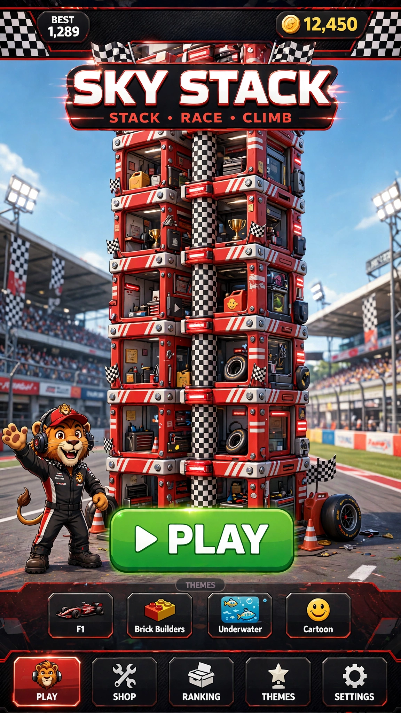
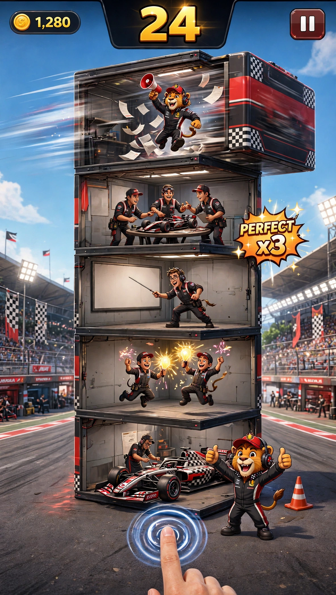
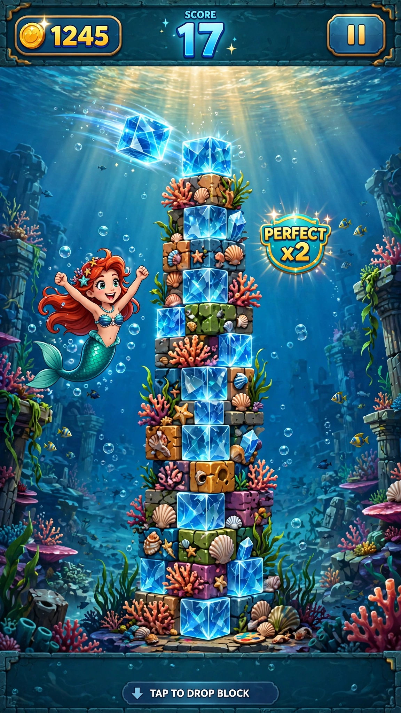

# SKY STACK — Apila Torres con 36 temas · Estudio + Plan

**Para:** Daniel · **De:** Niky (estudio de idea) · **Fecha:** 15/11/2026, 23:24 (hora de Madrid)
**Estado:** solo estudio, mockup y plan. **Por orden de Daniel (15/11 23:17, nuevo proceso 21:59): en cuanto terminen los 4 edificios (Simpson, LEGO, F1, Atlantis), el juego se fabrica SIN PARAR y SIN esperar aprobación, y se presenta mañana por la mañana en «Juegos para probar», listo para publicar. Daniel lo prueba y da el OK o no antes de publicar.**
**Prioridad máxima (23:15): las 4 torres y Apila Torres van PRIMERO, por delante de todo lo demás.**

---

## 1. VEREDICTO: SÍ — 32/35 · 🟢 FUERTE (el más alto de la lista)

**El juego es de APILAR: construyes un edificio EN VERTICAL, piso a piso, con precisión. Una pieza se desliza arriba; tocas y cae; lo que sobresale se corta y cae al vacío. Si no aciertas nada, se acabó la partida. Un toque, cero texto, y la torre que apilas ES la oficina Dana Games en el tema que elijas.**

**Veredicto honesto: SÍ, y es el juego principal después de los edificios (orden de Daniel 23:21).** La mecánica está probadísima a escala masiva (Stack, 70 millones de instalaciones, todavía actualizado en 2026), y lo que la hace nuestra es lo que Daniel pidió: **LA VISUAL LO ES TODO — los 36 temas ya creados, con sus piezas y sus personajes como assets fieles a su preview, animaciones de colocación, caída y celebración, personajes que reaccionan y una presentación premium. Si la visual sale bien, todo sale perfecto.**

**Condición escrita (sin ella, no es FUERTE):** el juego sale con **los 4 temas destacados completos (Turbo Racing, Brick Builders, Deep Sea, Toon Yellow) + la tienda con los 36 temas comprables con monedas del juego**; cada tema con su pack de assets fiel a su preview; **cero compras con dinero real en el lanzamiento** (solo monedas ganadas jugando + anuncios rewarded opt-in); y la curva de dificultad verificada por simulación antes de salir. Si sale con un solo tema, o con temas a medias, no es este juego.

**Título EN:** SKY STACK · **Título ES:** Apila Torres · **Slug:** `sky-stack` · **Género:** Arcade / apilar por precisión (estilo Stack, pero temático). **PEGI 3. No es contenido para niños.**

**Por qué no se llama «Tower Stack»:** ese nombre YA EXISTE — hay un juego popular de apilar que se llama así (lo citan los artículos del género junto a Stack). «Sky Stack» es el nombre propuesto; **verificar que está libre en Playgama antes de construir** (igual que se hizo con MIND MAGIC).

---

## 2. TEARDOWN DEL GÉNERO: A QUIÉN HAY QUE GANAR

**El mejor es Stack (Ketchapp), y sigue vivo:** 70 millones de instalaciones (AppBrain, noviembre 2026), 4,2★ con 408.928 valoraciones, lanzado en febrero de 2016 y **actualizado en octubre de 2026 (v4.1.1)** con modo nuevo «Stack City», misiones diarias y recompensas; todavía instala ~2.400 veces al día. Es el hiper-casual de apilar por antonomasia: un toque, bloques de colores planos, récord mundial.

**Qué vamos a superar (mínimo 3 puntos, con datos):**

| # | Stack (Ketchapp) | SKY STACK lo supera así |
|---|---|---|
| 1 | **Bloques planos de colores, sin temas ni personajes.** La torre es siempre la misma. | **36 mundos visuales completos** (ver catálogo, sección 4): cada tema cambia piezas, fondo, mascota, sonidos y colores. La torre que apilas es la oficina Dana Games vestida de F1, de Atlantis, de LEGO... Ningún Stack del mercado tiene esto. |
| 2 | **Sin colección ni progresión** (hasta 2026, que añadió Stack City + misiones). | **Tienda de temas con monedas desde el día 1** (sección 6): compras el tema que quieres con monedas ganadas jugando, eliges el estilo con el que juegas, misiones diarias y rachas de PERFECT. La colección ES la progresión. |
| 3 | **Sin personajes ni historia.** Juegas contra un número. | **Mascotas que reaccionan**: el león mecánico de F1, la sirena de Atlantis, el búho Anita... celebran tus PERFECT, se llevan las manos a la cabeza cuando cae un trozo, bailan cada 10 pisos. Son los jefes de la oficina en cada tema. |
| 4 | **Juice mínimo y frío.** El bloque cae y ya está. | **Juice en cada acción** (sección 7): squash al colocar, cámara lenta en la caída, vibración en el PERFECT, confeti cada 10 pisos, combo con sonido ascendente. Cada colocación es un momento de satisfacción. |

**Dónde NO le ganamos (honesto):** en descargas acumuladas (70M) ni en marca — Stack lleva 10 años. Le ganamos en que es un juego de 2016 con arte plano, y nosotros salimos en YouTube Jugables con 36 temas, personajes y colección, donde hoy no hay un Stack temático top.

---

## 3. PUNTUACIÓN: 32/35 · 🟢 FUERTE

Mismos 7 criterios de la lista de ideas (1–5 cada uno):

| Criterio | Puntos | Razón |
|---|---|---|
| Tendencia | 5 | Stack = 70M instalaciones, 4,2★, lanzado 2016 y **todavía actualizado en 2026** (v4.1.1, modo Stack City, ~2.400 instalaciones/día). El género de apilar es evergreen del hiper-casual, no una moda. Y tenemos 36 temas ya diseñados, que es justo lo que el género no tiene. |
| Competencia | 4 | Ketchapp es el gigante, pero su juego es minimalista y plano, sin temas, sin personajes y sin colección; en YouTube Jugables no hay un Stack temático top. Nos diferenciamos con 36 temas + mascotas + monedas. No es 5 porque la mecánica base es idéntica a la de Stack y copiable; la ventaja es la ejecución y el arte. |
| Viabilidad | 5 | Mecánica trivial de programar (un toque, pieza que se desliza, recorte del saliente, caída). Phaser 3 + plantilla YouTube Jugables. El trabajo es el arte — y el pipeline de packs de tema ya existe (es el mismo de la torre, orden 23:19). Un ciclo sin problema. |
| Potencial viral | 5 | **La caída ES el Short.** La torre cayendo a cámara lenta, el PERFECT x10, el cambio de tema en mitad del vídeo. Cada tema es un Short distinto. Stack ya demostró que apilar se ve; nosotros le ponemos 36 mundos encima. |
| Se entiende en 3 s | 5 | «Toca para soltar el bloque» — un toque, cero texto, cero tutorial que leer. La preview de Atlantis lo dice sola: TAP TO DROP BLOCK. Lo más simple de toda la lista. |
| Adicción | 4 | **El bucle «una más» es el más fuerte del hiper-casual** (Stack lo prueba con 70M) + colección de 36 temas + misiones diarias + rachas de PERFECT. No es 5 porque, una vez desbloqueados los temas favoritos, la retención descansa en batir el récord y las misiones; si las misiones se hacen repetitivas, baja a 3. |
| Monetización | 4 | Intersticial al perder (pausa natural, nunca a mitad de partida, nunca en la primera partida de la sesión) + rewarded opt-in (monedas y segunda oportunidad). Sin compras con dinero real en el lanzamiento (PEGI 3, limpio). No es 5 porque los ingresos son solo anuncios por diseño. |
| **TOTAL** | **32** | **FUERTE — el más alto de la lista (Mind Magic 29, Apila la Pizza y Limonada Exprés 29).** |

**Veredicto:** FUERTE. Merece concepto + mockup, y por orden de Daniel (23:17) se fabrica sin esperar aprobación en cuanto terminen los 4 edificios. La condición escrita de la sección 1 (4 temas destacados completos + tienda con los 36 + cero dinero real + curva verificada) es obligatoria.

---

## 4. CATÁLOGO COMPLETO DE TEMAS: LOS 36 (37 previews)

**Corrección honesta del conteo:** circulaba «38 previews válidas», pero contadas en disco (`~/workspace/torre-nuevos-disenos/`, 44 archivos webp) son **37 previews válidas distintas en 36 temas**: 44 archivos − 3 copias renombradas (Navidad/Disco/Noir) − 4 descartadas (acuarela, cine mudo, Western v1, Minions v1) = 37. Cyberpunk tiene 2 variantes (Daniel elige una como referencia del tema). **Los 4 destacados van primero; los otros 32 se desbloquean con monedas.**

**Nombres originales, sin marcas (obligatorio):** las previews se inspiran en estilos conocidos, pero el juego NO usa nombres de marcas ni personajes copiados (LEGO, Mario, Simpson, Minions, Minecraft, Roblox, Among Us, Pixar, F1 son marcas). Cada tema lleva su nombre propio y personajes originales. El mockup dice «F1» y «LEGO-brick»: en el juego real son «Turbo Racing» y «Brick Builders».

### 4.1 Los 4 destacados (orden de Daniel 23:21)

| Tema (juego) | Preview de referencia | Precio | Mascota |
|---|---|---|---|
| **Turbo Racing** (F1/carreras) | `media-generation-preview-edificio-f1-0-581dbeb5…webp` | **GRATIS (tema inicial)** | León mecánico de boxes |
| **Brick Builders** (ladrillos) | `media-generation-preview-edificio-lego-0-5f946b51…webp` | 100 | Constructor de bloques |
| **Deep Sea** (Atlantis) | `media-generation-preview-edificio-atlantis-0-a003a559…webp` | 150 | Sirena de pelo rojo (Anita) |
| **Toon Yellow** (sitcom amarilla) | `media-generation-preview-edificio-simpson-0-299743fc…webp` | 150 | Familia amarilla original |

### 4.2 Comunes — 150 monedas (12)

| Tema (juego) | Preview |
|---|---|
| Stick World (hombres de palo) | edificio-stickman |
| Clay World (plastilina) | edificio-plastilina |
| Origami | edificio-origami |
| Arcade 8-bit | edificio-8bit |
| Circus (circo) | edificio-circo |
| Pirates (piratas) | edificio-piratas |
| Vikings (vikingos) | edificio-vikingos |
| Samurai (Japón feudal) | edificio-samurai |
| Wild West (western v2) | edificio-western-v2 |
| Street Graffiti (graffiti) | edificio-graffiti |
| Winter Holidays (Navidad) | edificio-navidad |
| Disco 70s | edificio-disco |

### 4.3 Raros — 300 monedas (12)

| Tema (juego) | Preview |
|---|---|
| Magic School (escuela de magia) | edificio-magia |
| Pharaoh (Egipto) | edificio-egipto |
| Funny Zombies (zombies) | edificio-zombies |
| Super Heroes (superhéroes) | edificio-superheroes |
| Comic Book (cómic) | edificio-comic |
| Anime Pop (anime) | edificio-anime |
| Blocky World (bloques) | edificio-roblox |
| Voxel World (cubos) | edificio-minecraft |
| Space Beans (tripulación) | edificio-among-us |
| Dino World (dinosaurios) | edificio-dinosaurios |
| Fantasy Castle (castillo) | edificio-castillo |
| Jungle Treehouse (selva) | edificio-selva |

### 4.4 Épicos — 500 monedas (8)

| Tema (juego) | Preview |
|---|---|
| Neon City (cyberpunk, 2 variantes: Daniel elige una) | edificio-cyberpunk (x2) |
| Space Station (estación espacial) | edificio-espacial |
| Steam Factory (steampunk) | edificio-steampunk |
| Round World (3D suave) | edificio-pixar |
| Yellow Buddies (pequeños amarillos) | edificio-minions-v2 |
| Pipe World (plataformas) | edificio-mario |
| Dark Fairytale (gótico) | edificio-tim-burton |
| Noir Detective (detectives noir) | edificio-noir |

### 4.5 Excluidos (orden de Daniel)

| Preview | Por qué queda FUERA |
|---|---|
| Acuarela / cuento infantil | Descartada por Daniel 22:53 («malísima»). |
| Cine mudo en blanco y negro | Descartada por Daniel 22:53 («malísima»). |
| Western v1 | Descartada (v1 con salón en una planta y etiquetas duplicadas); vale la v2. |
| Minions v1 | Descartada (parrilla 3+2, contra la regla del edificio); vale la v2. |

---

## 5. DISEÑO: CÓMO SE VERÍA

**Dirección de arte:** la torre que apilas es la oficina Dana Games vestida de cada tema: piezas que son plantas del edificio (boxes de F1, ladrillos, cristales de coral, papel de cómic...), fondo vivo del mundo, y una mascota del tema que reacciona a todo. La visual lo es todo: cada tema se reconoce en el primer fotograma, sin leer nada.

### Mockup (diseño acabado, menú F1, 9:16)

Título SKY STACK, torre de boxes rojos de F1, león mecánico saludando, botón PLAY verde enorme, selector de temas (Turbo Racing, Brick Builders, Deep Sea, Cartoon), monedas y BEST arriba. Este es el diseño que marca la dirección.

### Preview de trabajo 1 (partida F1, HUD real)

Partida en marcha: piso 24, 1.280 monedas, pausa, PERFECT x3, la pieza deslizándose arriba con estela de velocidad, el dedo tocando para soltarla. La preview es referencia de estilo y de HUD, no un fotograma literal: el juego real adapta el estilo a la jugabilidad.

### Preview de trabajo 2 (partida Atlantis, HUD real)

Segundo tema para probar que el cambio de mundo funciona: torre de coral y cristales azules, la sirena celebrando, PERFECT x2, «TAP TO DROP BLOCK». Misma mecánica, otro mundo.

**Desviaciones honestas de las imágenes (a corregir al construir):**
- El mockup pone «F1» en el selector: en el juego real es **Turbo Racing** (marca). Y «LEGO-brick» ya se corrigió a **Brick Builders**.
- El botón del león abajo a la izquierda repite «PLAY» (ya hay un PLAY grande): en el juego real ese botón es **DAILY** (misión diaria).
- En la preview F1 la mascota sale DOS veces en el mismo fotograma (arriba saltando con el megáfono y abajo a la derecha): en el juego real, **una sola mascota** por pantalla.
- La sirena de Atlantis se parece MUCHO a Ariel (pelo rojo, cola verde, top de concha): es lo que pidió Daniel («parecido a la sirenita»), pero al construir se diferencia más (peinado, cola, colores) para que sea un personaje original.
- Las monedas del mockup (12.450) y de las previews (1.280, 1.245) son cifras de ejemplo: el juego real empieza en 0.

---

## 6. EL JUEGO: CONCEPTO Y MECÁNICA PASO A PASO

**Concepto en una frase:** apila los pisos de la oficina Dana Games sin que se caiga la torre — un toque, un piso, y el tema que tú elijas.

**Vista:** 2D lateral (retrato 390×844), piezas con cara superior y sombreado para que se lean en 3D, cámara que sube suave con la torre. Sin 3D real: Phaser 3 en 2D, que es lo que la plantilla domina y lo que cabe en el zip.

### 6.1 Una partida (10 segundos para aprenderla, años para dominarla)

1. **La pieza se desliza** arriba de la torre, de lado a lado. Cada piso alterna la dirección (izquierda→derecha, derecha→izquierda).
2. **Tocas en cualquier parte de la pantalla** y la pieza cae. No hay botones durante la partida: toda la pantalla es el botón (≥88 px de sobra).
3. **Lo que sobresale se corta y cae** con física (gira, rebota en el suelo, polvo). Lo que queda es tu nuevo piso, más estrecho si fallaste por poco.
4. **PERFECT si clavas la pieza** (desplazamiento ≤ 4 px): la pieza encaja con un brillo, suena el arpegio, la mascota celebra y sumas combo.
5. **Si no aciertas nada** (solape 0), la pieza cae al vacío y se acaba la partida. Pantalla de fin con piso, monedas ganadas y BEST; reintento en un toque; segunda oportunidad con rewarded opt-in (una por partida).

### 6.2 Curva de dificultad (verificada por simulación, no por intuición)

Velocidad de deslizamiento (px/s, pantalla 390 px, pieza inicial 120 px de ancho):

| Pisos | Velocidad | Qué cambia |
|---|---|---|
| 1–5 | 140 | Aprendes: lento, dirección alterna |
| 6–10 | 180 | Ritmo de partida normal |
| 11–15 | 220 | Hay que mirar de verdad |
| 16–20 | 260 | Fallos por poco frecuentes |
| 21–30 | 300 | Solo rachas buenas llegan aquí |
| 31–40 | 340 | Zona de récord |
| 41+ | 380 | Límite humano; cada piso es un logro |

**Invariante (se comprueba en el prototipo):** con 100 partidas simuladas (bot con error de reacción normal, σ ≈ 8 px), la mediana de un jugador nuevo es 15–25 pisos y un jugador bueno supera los 40. Si la mediana sale <10 o >35, se retoca la curva, no se discute.

### 6.3 Monedas y economía (todos los temas comprables, orden 23:22)

**Cómo se ganan (solo jugando, nunca con dinero real en el lanzamiento):**

| Fuente | Monedas |
|---|---|
| Cada piso colocado | +1 |
| Cada PERFECT | +2 extra |
| Cada tramo de 10 pisos | +10 extra |
| Misión diaria (p. ej. «llega al piso 20 en Turbo Racing») | +25 |
| Rewarded opt-in (anuncio visto entero) | +50 |
| Segunda oportunidad tras caer (rewarded, 1 por partida) | — (no son monedas) |

**Cuentas honestas:** un jugador nuevo hace ~18 pisos y ~4 PERFECT por partida → 18 + 8 = **~26 monedas/partida**. Un jugador bueno (40 pisos, ~12 PERFECT) → 40 + 24 + 40 (tramos) = **~104 monedas/partida**. Un tema común (150) son ~6 partidas (~15 min); un épico (500) son ~19 partidas + misiones. **Desbloquear los 36 temas cuesta 9.800 monedas en total** (100 + 150 + 150 + 12×150 + 12×300 + 8×500) — la colección completa es el gancho de meses, no de un día. La tienda enseña TODOS los temas desde el día 1 (con su preview, su precio y su estado: comprado / comprable / bloqueado), y el jugador elige el estilo con el que juega en un toque.

**Monetización (ads, sin dinero real):** intersticial al perder (pausa natural, nunca a mitad de partida, nunca en la primera partida de la sesión); rewarded opt-in para +50 monedas o segunda oportunidad. Guardado SOLO con `bridge.storage` (monedas, temas comprados, BEST, misiones). Sin IAP en el lanzamiento; si Daniel quiere compras con dinero real más adelante, es una decisión suya, no de este estudio.

**Misiones diarias (para que vuelvan mañana):** 1 misión al día, rotando tema y reto («llega al piso 15 con Deep Sea», «consigue 5 PERFECT seguidos», «coloca 50 pisos en total»). +25 monedas. Racha de días seguidos: +5 extra por día de racha (máx. +25).

**El Short (el momento para grabar):** la caída a cámara lenta + el PERFECT x10 + el cambio de tema. 8–10 s, acaba en la celebración (nunca en la derrota).

---

## 7. ASSETS: MANIFIESTO COMPLETO Y ANIMACIONES (nivel TOP, orden 23:22)

**Formato de pack compartido con la torre (orden 23:19):** cada tema es un pack con el mismo formato que los packs de la torre (`tema.json` + assets + README). El trabajo de los 4 edificios alimenta directamente el juego: mismo `tema.json`, mismos sprites base, distinta composición. Un tema = un pack; 36 packs.

### 7.1 Qué lleva cada pack de tema (9 visuales + 4 sonidos)

| Asset | Qué es | Ejemplo (Turbo Racing) |
|---|---|---|
| `piece-base` | Pieza normal del tema | Box de boxes rojo/blanco |
| `piece-mid` | Variante de mitad de torre | Box con trofeo/neumático |
| `piece-top` | Variante de coronación (cada 10 pisos) | Box con bandera a cuadros |
| `piece-fall` | Trozo cortado que cae | Esquina del box rota |
| `background` (2 capas) | Fondo con parallax | Grada + cielo de circuito |
| `mascot-idle` | Mascota en espera (parpadea, respira) | León mecánico |
| `mascot-cheer` | Mascota celebrando (salta, brazos arriba) | León con megáfono |
| `mascot-panic` | Mascota asustada (manos a la cabeza) | León tapándose los ojos |
| `ui-tint` | Paleta del tema (3–5 colores + acento) | Rojo/negro/cuadros |
| `sfx-place` / `sfx-perfect` / `sfx-fall` / `sfx-fanfare` | Sonidos del tema | «thock» de box, arpegio, whoosh, fanfarria de podio |

**Total: 36 packs × 13 = 468 piezas de contenido (324 visuales + 144 sonidos) + ~25 compartidos** (moneda, botones, HUD, partículas, logo SKY STACK, tipografía). Los sonidos comparten base por familia (los 4 SFX se adaptan por tema con pitch/timbre, no se graban 144 sonidos distintos desde cero).

### 7.2 Animaciones e interacciones (nada a medias)

| Momento | Animación | Sonido | Mascota |
|---|---|---|---|
| Colocación normal | Squash al aterrizar + nube de polvo + cámara que sube suave | «thock» + tick háptico | Mira la pieza, asiente |
| PERFECT | Encaje con anillo de brillo + badge PERFECT xN que salta + destello sutil desde x5 | Arpegio ascendente con el combo | Salta y celebra |
| Corte (saliente) | Trozo que gira y cae con gravedad, rebota en el suelo, polvo | Whoosh + golpe sordo | Se lleva las manos a la cabeza |
| Derrota (fallo total) | Cámara lenta: la pieza cae, la torre queda, panel de fin que sube | Silencio + sting corto triste | Triste, mira al suelo |
| Tramo de 10 pisos | Ventanas que se encienden, confeti, +10 monedas flotando | Fanfarria corta | Baila |
| Cambio de tema | Transición de 0,4 s: la torre se reconstruye con las piezas nuevas | Whoosh de cambio | Saluda con su animación |
| Racha diaria | Tarjeta de misión que se marca, +25 monedas | Monedas cayendo | Pulgar arriba |

**Interacciones continuas:** la mascota sigue la pieza deslizante con los ojos; parpadea y respira en idle; el fondo tiene vida propia por tema (banderas que ondean en F1, burbujas que suben en Deep Sea, copos en Winter). Todo el juego se entiende sin leer: el estado se lee en la imagen, no en el texto.

### 7.3 Oleadas de fabricación (el arte no se hace de golpe)

| Oleada | Temas | Cuándo |
|---|---|---|
| 1 (destacados) | Turbo Racing, Brick Builders, Deep Sea, Toon Yellow | Antes de la primera build jugable |
| 2 (comunes) | Los 12 comunes | En paralelo, 1 agente por tema |
| 3 (raros) | Los 12 raros | En paralelo, 1 agente por tema |
| 4 (épicos) | Los 8 épicos | En paralelo, 1 agente por tema |

Cada pack pasa el gate de arte antes de entrar (fiel a su preview, verificado a 390 px, sin placeholders). **Nada entra a medias:** un tema sin su pack completo no aparece como comprable, aparece como «próximamente» con su preview — pero el objetivo de mañana es que los 36 estén listos para probar.

---

## 8. SKILLS: QUÉ CONSTRUYE CADA PARTE

Revisadas las 147 del kit una a una (66 en `main` + 81 nuevas del commit c7a9201, informe `comunicacion-ias/informe-skills-calidad-2026-11-15.md`) + 13 de oficina + 10 de SpriteCook. Selección para este juego (SpriteCook NO se usa: decisión de Daniel 21:03; `ui_ux_pro_max` Premium NO se usa: pendiente de decisión de Daniel; `game-playtest-squad-skill` PENDIENTE de licencia — prioridad nº 1; `game-audio` PENDIENTE de LICENSE — mientras cubren `audio-design` y `audio-and-sound`):

| Parte | Skills |
|---|---|
| Dirección de arte (36 temas, fieles a su preview) | `art-bible` (identidad por tema), `directing-game-visuals` (el estado se lee sin texto), `create-game-assets` (manifiesto + familias de assets), `theme-factory` (oficina: packs de tema) |
| Piezas, mascotas, fondos | `generate2dsprite` (piezas y mascotas), `sprite-atlas` (empaquetado), `spine-skeletal` (mascotas animadas), `pixel-animation` (solo tema 8-bit), `vfx-generate` (brillo, confeti, polvo), `character-rig` (mascotas) |
| Física de caída y recorte | `physics-tuning` (timestep fijo, el saliente cae sin explotar), `phaser-arcade-physics` (cuerpos y colisiones), `implementing-gameplay-invariants` (la invariante: el recorte es exacto) |
| Cámara que sube con la torre | `camera-systems` (follow con deadzone + look-ahead, sin tirones), `cameras` (arte) |
| Dificultad y economía | `difficulty-and-balancing` (curva por simulación), `evaluating-gameplay-balance` (100 partidas simuladas), `balance-design` (precios de la tienda), `designing-minimal-game-rules` (una regla: toca y cae) |
| Controles (un toque) | `input-systems` (toda la pantalla es el botón, buffer de toques), `mobile-native` (táctil), `gating-intent-legibility` (se entiende en 3 s) |
| Feel de cada colocación | `maximizing-game-feel`, `action-feel`, `game-feel`, `game-juice`, `juice-vfx`, `juice-audit` (auditoría del momento de colocar), `haptic-rumble` (vibración en PERFECT), `tweens`, `particles`, `gsap-core` (tweens de la plantilla) |
| UI/HUD/tienda (monedas, temas, misiones) | `game-ui-ux-pro-max` (botones ≥88 px, hitArea centro + 4 esquinas), `game-ui-ux`, `game-ui-taste`, `taste-skill` (nada genérico), `styling-web-game-typography` (números grandes y legibles) |
| Tutorial (cero texto) | `onboarding-and-teaching` (enseñar haciendo: la mano oficial `kit/mano-tutorial.png`), `tutorial-for-game` |
| Guardado (monedas, temas, BEST) | `save-systems` (slots y migración), `playgama-bridge` (SOLO `bridge.storage`, prohibido localStorage) |
| Plataforma (Playgama + YouTube Jugables) | Plantilla (PR #4 dana-games-juegos) + `playables-sdk-integration`, `playgama-publish`, `certification-checklist`, `performance-budget` (bundle <15 MiB, zip ≤5 MB, <5 s) |
| Progresión y retención | `pacing-and-the-player-journey` (sesiones de 1–3 min), `game-engagement-ideas` (dónde abandonan y por qué), `level-design` (tramos de 10 pisos), `game-design-fundamentals`, `designing-mini-games` |
| Legibilidad a 390 px | `auditing-game-screen-readability`, `art-direction-and-readability`, `scale-and-responsive`, `mobile-games` |
| Rendimiento | `performance-optimization`, `web-game-performance` (60 FPS en móvil real), `loading-assets` (carga <5 s) |
| Sonido | `audio-design`, `audio-and-sound`, `audio-feel` (sonido de la colocación y del PERFECT) |
| Prototipo desechable | `prototype-fast` (la mecánica en crudo, sin arte, antes de invertir en 36 packs) |
| Marketing (Short de la caída) | `hook-writer` (gancho 0–3 s), `thumbnail-design` (la torre cayendo), `playgama-game-video`, `youtube-shorts`, `virality` |
| Calidad (gates) | `asset-audit`, `review-game`, `game-quality-gates`, `game-polish-audit`, `smoke-testing-web-games`, `playtest-report`, `probing-web-game-mechanics`; `game-playtest-squad-skill` (PENDIENTE de licencia) |
| Documentación | `game-docs` (GDD de una página) |
| Oficina (torre, selector) | `theme-factory`, `diorama`, `web-artifacts-builder` (packs compartidos torre ↔ juego) |
| NO se usan | `threejs-skills` (13, el juego es 2D), `blender-*` (9, sin 3D), `tilemaps`, `generate2dmap`, `game-ai`, `platformer` (no es un plataformas), `video2dsprite`, SpriteCook (10, decisión de Daniel), `ui_ux_pro_max` (Premium, pendiente) |

---

## 9. PLAN: QUÉ FALTA PARA MAÑANA POR LA MAÑANA

**Hecho en este estudio:** teardown con datos reales, puntuación 32/35, catálogo completo de 36 temas con economía, mockup, 2 previews de trabajo, manifiesto de assets, skills seleccionadas.

**Pendiente (en orden, según las 14 obligaciones + órdenes de Daniel 23:16/23:17/23:20/23:23):**

1. **Terminar los 4 edificios** (Simpson, LEGO, F1, Atlantis) — en marcha, otros agentes. Sus packs de tema alimentan el juego. **Si algo bloquea, se dice ya y se sigue con lo siguiente (orden 23:23).**
2. **Preparar assets + código base** (esta noche, en cuanto el estudio esté entregado): manifiesto de assets por pack + base Phaser 3 desde la plantilla (PR #4) con la mecánica en crudo.
3. **Prototipo desechable:** la mecánica sin arte (pieza que se desliza, recorte, caída) + simulación de 100 partidas para validar la curva. Si el prototipo no engancha en 10 s, se cambia la mecánica, no se sigue adelante.
4. **Arte premium primero, fiel a las previews:** oleada 1 (4 destacados) completa y verificada a 390 px; oleadas 2–4 en paralelo (1 agente por tema). Sin placeholders.
5. **Código con la plantilla** (Phaser 3 + TS + Vite, Bridge + ytgame, juice en cada colocación, guardado solo con bridge.storage, intersticial solo al perder y nunca en la primera partida de la sesión, rewarded opt-in, botones ≥88 px, hitArea con test centro + 4 esquinas + toque fuera).
6. **Preview EXACTA desde dentro jugando** (HUD real, partida en marcha) como guía visual — las 2 previews de este estudio son la base; se hace la exacta de la build real antes de publicar.
7. **Playtest humano 3 de 3** (¿entienden «toca para soltar» en 3 s? ¿quieren «una más»?). Si no, se vuelve al prototipo.
8. **QA técnica** (0 defectos táctiles, <5 s, <15 MiB, 60 FPS, 0 errores, zip ≤5 MB, portadas 800×800 / 1080×1920 / 1920×1080 con el sello Dana Games, listing EN+ES, capturas 390×844, GIF 8–10 s que acaba en celebración).
9. **Revisión cruzada** de todos los agentes (gráficos, jugabilidad, adicción, gameplay, todo) antes de presentar.
10. **Mañana por la mañana: presentar en «Juegos para probar»**, listo para publicar. Daniel lo prueba y da el OK o no. Sin su visto bueno no se publica nada.
11. Publicar en Playgama / YouTube Jugables (EN primero, PEGI 3, no niños, original — nunca copiar a Stack, solo orgánico). **Pendiente verificar que el título SKY STACK está libre en Playgama antes de construir.**
12. Short + marketing (la caída a cámara lenta, 8–10 s).
13. Métricas y siguiente juego (la fábrica no se para).

---

## 10. RIESGOS HONESTOS (para que Daniel los sepa antes de mañana)

- **El volumen de arte (36 packs, ~350 assets):** es el riesgo nº 1. La defensa es el pipeline de packs compartido con la torre + generación en paralelo (1 agente por tema) + gate de arte por pack. Si mañana por la mañana no están los 36 packs perfectos, se presenta con los 4 destacados + los packs terminados, y el resto entra en la siguiente oleada — pero eso se dice, no se esconde.
- **Que se parezca demasiado a Stack:** la mecánica es la misma (no se puede patentar apilar bloques), pero el arte, los temas, las mascotas y la colección son nuestros. El riesgo legal es cero si no copiamos nombre, arte ni sonidos de Ketchapp. «Tower Stack» ya se descartó como nombre por existir.
- **Que el jugador se aburra al desbloquear sus temas favoritos:** la defensa es la colección (36 temas), las misiones diarias y el récord. Si las misiones se hacen repetitivas, la retención cae — se vigila con las métricas de la semana 1.
- **La curva de dificultad:** si la velocidad sube demasiado rápido, el jugador nuevo abandona en el piso 8; si sube demasiado lento, el bueno se aburre. Por eso la curva se verifica por simulación (100 partidas) antes de salir, no a ojo.
- **Nombres de temas con marca:** el mockup dice «F1» y «LEGO-brick»; el juego real dice «Turbo Racing» y «Brick Builders». Si un solo asset lleva una marca, se retira antes de publicar.

---

**Fuentes (verificadas 15/11/2026):** Stack de Ketchapp: 70M instalaciones, 4,2★, 408.928 valoraciones, lanzado febrero 2016, v4.1.1 del 19/10/2026 con modo Stack City, ~2.400 instalaciones/día (AppBrain, noviembre 2026; Google Play 50M+); «Tower Stack» como juego existente del género (artículos comparativos de block stackers, 2026); catálogo de temas verificado en disco: 44 archivos webp en `~/workspace/torre-nuevos-disenos/` (37 previews válidas, 36 temas, 4 descartadas); manifiesto `MANIFIESTO.md` (667 líneas).
