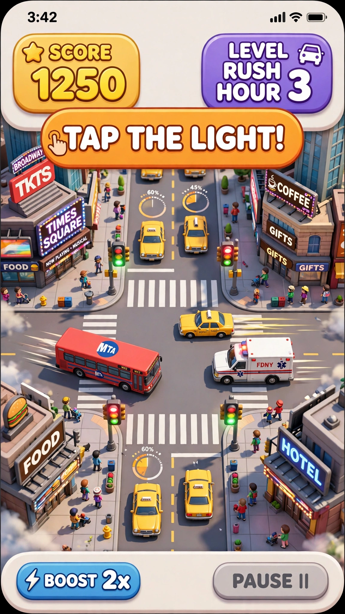
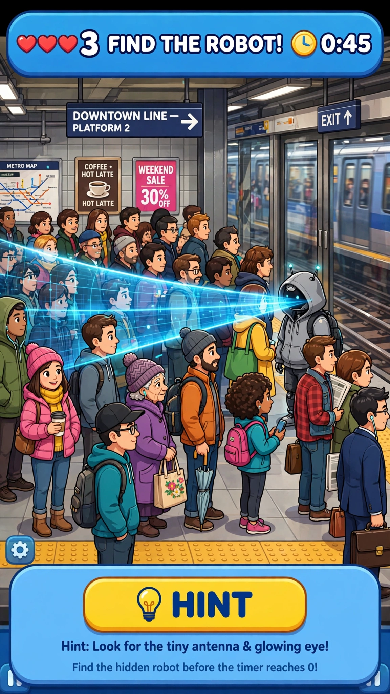
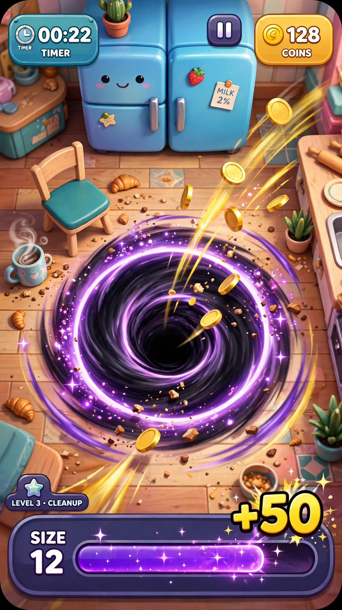

# Lista de ideas puntuadas — Dana Games · 15/11/2026

**Para:** Daniel · **De:** Niky (fábrica de ideas) · **Fecha:** 15/11/2026, 19:00 (hora de Madrid)
**Estado:** solo puntuación y propuestas. **Nada se fabrica.** Cada juego necesita que Daniel apruebe antes el concepto y el mockup del diseño acabado (regla del 15/11, 17:51).

## Cómo se ha puntuado

Cada idea, de 1 a 5 en 7 criterios (total sobre 35), con los criterios del fichero **más el listón nuevo de Daniel**:

| Criterio | Qué mide |
|---|---|
| Tendencia | ¿El género está caliente ahora? (datos del análisis de competencia del 15/11) |
| Competencia | Posición favorable: 5 = casi nadie lo hace o nos diferenciamos claro; 1 = un líder casi idéntico |
| Viabilidad | ¿Se puede hacer bien en un ciclo, con Phaser 3 + arte premium primero? |
| Potencial viral | ¿Tiene un momento grabable para un Short? |
| Se entiende en 3 s | ¿El verbo se pilla al primer toque, sin leer nada? |
| Adicción | ¿Hay niveles cortos, meta visible y ganas de «una más»? |
| Monetización | ¿Anuncios en pausas naturales + rewarded con sentido? (Playgama 75/25) |

Y el listón nuevo aplicado a todas: **gancho en 10 segundos, mecánica que enganche, arte que PUEDA ser premium** (el arte es la mecánica, no un envoltorio), encaje en YouTube Jugables y móvil vertical, originalidad. Si no imagino su pantalla principal a nivel top, la idea no pasa.

**Veredictos:** 🟢 **FUERTE** = merece concepto + mockup. 🟡 **DUDOSA** = solo si se cumple la condición que se dice. 🔴 **DÉBIL** = descartar antes de enseñársela a nadie, con el motivo.

## Tres correcciones honestas antes del ranking

1. **Traffic Chaos: New York Rush no estaba en `ideas-acumuladas.json`.** Es la idea del propio Daniel (su GDD, escenario Nueva York desde las 11:52) y el análisis de competencia ya le hizo mockup. La puntúo y **la añado al JSON como apta** para que no se pierda.
2. **KO Relámpago NO se puntúa.** Daniel lo canceló el 15/11 a las 11:49 y se borró por completo. Lo muevo de aptas a no aptas en el JSON con ese motivo. En el fichero de la rama de descartes aún figuraba como apta.
3. **Mudanza Extrema NO se puntúa.** Orden de Daniel (11:31): Moving Mayhem ya está listo, fuera de alcance. Queda en aptas como está, sin puntuación.

Contadas así: 16 ideas existentes puntuadas (15 del pool + Traffic Chaos) + 7 nuevas mías = **23 en el ranking**. Las 5 descartadas hoy por Daniel (Seagull, Gummy, Estampida, Barista, Cofre) ya están en no aptas y no aparecen.

## El ranking (de mayor a menor)

| # | Idea | Género | Total /35 | Veredicto |
|---|---|---|---|---|
| 1 | **Traffic Chaos: New York Rush** | Arcade de tráfico | **31** | 🟢 FUERTE |
| 2 | **Apila la Pizza** ⭐ nueva | Física / apilar | **29** | 🟢 FUERTE |
| 3 | **Limonada Exprés** ⭐ nueva | Servir rápido | **29** | 🟢 FUERTE |
| 4 | **¿Quién es el Robot?** | Encontrar al impostor | **28** | 🟢 FUERTE |
| 5 | **Agujero Tragón en la Cocina** | Comer y crecer | **28** | 🟢 FUERTE |
| 6 | **Dibuja el Puente del Repartidor** | Dibujar con física | **28** | 🟢 FUERTE |
| 7 | **Cuchillo Saltarín** | Arcade de cortar | **28** | 🟢 FUERTE |
| 8 | **Carrito Loco del Súper** ⭐ nueva | Runner + tycoon | **28** | 🟢 FUERTE |
| 9 | **Peluquería Loca** ⭐ nueva | Belleza / moda | **27** | 🟢 FUERTE |
| 10 | **El Gran Escape del Museo** ⭐ nueva | Dibujar para escapar | **27** | 🟢 FUERTE |
| 11 | **Pesca el Tesoro** ⭐ nueva | Arcade de pesca | **26** | 🟡 DUDOSA |
| 12 | **Colada Caótica** | Puzle de ordenar | **26** | 🟡 DUDOSA |
| 13 | **Defiende la Cocina** ⭐ nueva | Estrategia ligera | **25** | 🟡 DUDOSA |
| 14 | **Cinta de Sushi Glotona** | Puzle de cinta (flow) | **25** | 🟡 DUDOSA |
| 15 | **Muñeco Antiestrés** | Ragdoll | **25** | 🟡 DUDOSA |
| 16 | **El Brazo Largo de la Abuela** | Dibujar ruta | **24** | 🟡 DUDOSA |
| 17 | **Paraguas contra la Borrasca** | Física / equilibrio | **24** | 🟡 DUDOSA |
| 18 | **Funda de Móvil DIY** | Simulación ASMR | **24** | 🟡 DUDOSA |
| 19 | **Borra la Mentira** | Borrar una parte | **23** | 🟡 DUDOSA |
| 20 | **Emoji Parejas Locas** | Unir parejas | **23** | 🔴 DÉBIL |
| 21 | **Churrería Idle** | Gestión idle | **22** | 🔴 DÉBIL |
| 22 | **Desfile Exprés** | Vestir y votar | **20** | 🔴 DÉBIL |
| 23 | **El Trastero Secreto** | Objetos ocultos | **20** | 🔴 DÉBIL |

**Resumen:** 10 FUERTES, 9 DUDOSAS, 4 DÉBILES. Mi recomendación: que Daniel elija 2–3 de las 10 FUERTES para hacerles concepto + mockup. Nada más hasta que él diga.

---

## 🥇 1. Traffic Chaos: New York Rush — 31/35 · 🟢 FUERTE

**Género:** arcade cenital de gestión de tráfico · **Título EN:** Traffic Chaos: New York Rush · **Origen:** GDD del propio Daniel.

**Jugabilidad:** tocas los semáforos para ponerlos en verde o en rojo; cada coche tiene paciencia de 8 segundos y si se agota, choque en cadena a cámara lenta. Aceleras con swipe. Cada cruce es una decisión: ¿a quién dejo pasar?

**Gancho en 10 s:** el primer semáforo en verde + el primer choque en cadena a cámara lenta.

**Por qué puede ser premium:** diorama 2.5D de juguete de Times Square — taxi amarillo, autobús MTA, ambulancia FDNY. El arte ES la ciudad: cada vehículo se reconoce por color y forma, sin leer. El análisis de competencia ya le hizo mockup (abajo) y lo verificó.

**Puntuación:** tendencia 5 · competencia 4 · viabilidad 4 · viral 5 · 3 s 5 · adicción 4 · monetización 4.
**Evidencia:** Simulation es el género nº 1 por plays (1,4B, ~24 %); física de coches, 365K plays/día (Mediacube). Referencias: Draw Crash Race + Crime — Traffic Chaos añade decisiones donde ellos solo tienen caos.
**Veredicto:** FUERTE. La nº 1 clara: idea de Daniel, mockup ya hecho, género caliente, gancho inmediato.

---

## 🥈 2. Apila la Pizza — 29/35 · 🟢 FUERTE ⭐ nueva

**Género:** física / apilar (arcade) · **Título EN:** Pizza Stack Panic.

**Jugabilidad:** cae un ingrediente desde arriba y tocas para soltarlo sobre la torre. La torre se tambalea, el queso se estira, y si cae mal, derrumbe a cámara lenta con los ingredientes por el suelo. Combo por colocación perfecta. Cada nivel es un pedido más alto: pizza, hamburguesa, tarta.

**Gancho en 10 s:** la primera suelta + el tambaleo + el queso estirándose.

**Por qué puede ser premium:** cocina 3D de juguete con luz cálida, ingredientes con volumen, vapor, queso que se estira. La torre ES tu estado, como la pila de bloques de Bridge Race (71M plays): se ve cuánto llevas sin mirar ningún HUD.

**Puntuación:** tendencia 4 · competencia 4 · viabilidad 4 · viral 4 · 3 s 5 · adicción 4 · monetización 4.
**Evidencia:** los puzles y arcades de física lideran Casual en EE. UU. (Royal Smash! nº 1). No hay un líder de apilar-pizza en el top de Playables.
**Veredicto:** FUERTE. Un dedo, un verbo, un momento de juice por acción. La más «juguete» de la lista.

---

## 🥉 3. Limonada Exprés — 29/35 · 🟢 FUERTE ⭐ nueva

**Género:** arcade de servir rápido (time-management) · **Título EN:** Lemonade Rush.

**Jugabilidad:** los clientes llegan con su pedido en un bocadillo (limonada, hielo, fresa). Tocas los ingredientes en orden y sirves antes de que se agote su paciencia. Servir 3 seguidos = combo, monedas volando y cliente bailando de alegría. Oleadas de hora punta cada vez más rápidas.

**Gancho en 10 s:** el primer cliente servido + monedas volando + su bailecito.

**Por qué puede ser premium:** puesto de limonada al sol, condensación en el vaso, cubitos de hielo, el chorro al exprimir. El exprimido ES el momento de juice. Nada que ver con la Churrería Idle: esto es rápido, no esperar.

**Puntuación:** tendencia 4 · competencia 4 · viabilidad 5 · viral 3 · 3 s 5 · adicción 4 · monetización 4.
**Evidencia:** Store & Tycoon, 286K plays/día (Mediacube); My Mini Mart, 63M plays — el tema de tienda funciona, y aquí es servir rápido en vez de idle.
**Veredicto:** FUERTE. La más fácil de hacer bien de las 10 primeras, y con meta claro (mejoras del puesto, recetas nuevas, barrios).

---

## 4. ¿Quién es el Robot? — 28/35 · 🟢 FUERTE

**Género:** encontrar al impostor · **Título EN:** Spot the Robot.

**Jugabilidad:** escaneas la multitud del andén con un haz; el robot se delata por un detalle (antena, ojo brillante, articulación). Tienes 0:45 y 3 corazones. Pistas integradas.

**Gancho en 10 s:** el primer escaneo revela un robot.

**Por qué puede ser premium:** andén de metro con multitud con volumen — cada persona es un personaje, no un sprite repetido. El color y el detalle SON la mecánica (patrón Camo Sniper 3D, 2,5M plays). Mockup ya hecho y verificado (abajo).

**Puntuación:** tendencia 4 · competencia 4 · viabilidad 4 · viral 4 · 3 s 4 · adicción 4 · monetización 4.
**Evidencia:** Find the Alien, 54M plays; Find the Vampire (Playgama), 17M. Formato probado, pocos clones.
**Veredicto:** FUERTE. El riesgo es el arte: la multitud tiene que ser personajes de verdad. Si el mockup convence, es de las más seguras.

---

## 5. Agujero Tragón en la Cocina — 28/35 · 🟢 FUERTE

**Género:** comer y crecer · **Título EN:** Kitchen Hole Muncher.

**Jugabilidad:** arrastras un agujero negro que se traga la cocina — de las migas a la nevera. Creces con lo que tragas, cada objeto vale monedas, el tiempo aprieta.

**Gancho en 10 s:** la primera tragada + el agujero creciendo delante de tus ojos.

**Por qué puede ser premium:** cocina cenital de juguete 3D — nevera, mesa, sillas, plantas. Cada objeto es reconocible y cómico al ser tragado. El crecimiento ES el progreso. Mockup ya hecho y verificado (abajo).

**Puntuación:** tendencia 4 · competencia 3 · viabilidad 4 · viral 4 · 3 s 5 · adicción 4 · monetización 4.
**Evidencia:** Hole.io, 76M plays; patrón Snake Clash (107M) / Bridge Race (71M: comer el mapa). En 2D cenital la competencia es media, no alta como en 3D.
**Veredicto:** FUERTE. Escala cómica (de las migas a la nevera) y cada nivel es una cocina distinta.

---

## 6. Dibuja el Puente del Repartidor — 28/35 · 🟢 FUERTE

**Género:** dibujar con física · **Título EN:** Draw Bridge Delivery.

**Jugabilidad:** dibujas un puente para que la moto del repartidor llegue con la pizza entera. Tinta limitada: estrellas según la tinta usada. Si el puente se rompe, la pizza vuela a cámara lenta.

**Gancho en 10 s:** el primer puente dibujado + la moto cruzándolo.

**Por qué puede ser premium:** la ciudad al atardecer, la moto con volumen, la pizza como tesoro. Tu dibujo ES el puente (patrón Draw Crash Race: tu dibujo es el coche).

**Puntuación:** tendencia 5 · competencia 3 · viabilidad 4 · viral 4 · 3 s 4 · adicción 4 · monetización 4.
**Evidencia:** Draw Bridge, 27M plays (top 3 de Playgama); Draw Crash Race, 968K en 7 días. Dibujar/escapar es la mecánica nº 1 que escala en 2026.
**Advertencia:** Draw Bridge es el líder directo — hay riesgo de parecer clon. El giro del repartidor + la pizza tiene que verse en la portada, no solo en la descripción.
**Veredicto:** FUERTE, con esa condición.

---

## 7. Cuchillo Saltarín — 28/35 · 🟢 FUERTE

**Género:** arcade de cortar · **Título EN:** Flip Knife Chef.

**Jugabilidad:** un toque y el cuchillo da una voltereta cortando verduras en rodajas, con sonido satisfactorio. Niveles de 20–40 s con multiplicador final por precisión.

**Gancho en 10 s:** el primer toque = la primera voltereta + la primera rodaja.

**Por qué puede ser premium:** verduras con volumen y jugo, tabla de madera con textura, el corte con su sonido. El corte ES el juego.

**Puntuación:** tendencia 4 · competencia 3 · viabilidad 5 · viral 4 · 3 s 5 · adicción 3 · monetización 4.
**Evidencia:** Slice It All!, 26M plays; Fork N Sausage, 42M.
**Advertencia (lección del Cofre):** una sola acción repetida es la trampa que mató al Cofre del Doblón. Necesita el meta de combos y multiplicador desde el primer diseño, o se queda en juguete.
**Veredicto:** FUERTE, con el meta de combos obligatorio.

---

## 8. Carrito Loco del Súper — 28/35 · 🟢 FUERTE ⭐ nueva

**Género:** runner arcade + tycoon · **Título EN:** Supermarket Cart Dash.

**Jugabilidad:** conduces el carrito con un dedo (arrastrar izquierda/derecha), recoges lo de la lista de la compra y esquivas derrames y otros clientes. Al llegar a caja, el botín financia tu propio minimercado (estanterías, productos, zonas).

**Gancho en 10 s:** el primer viraje + la compra volando al carrito.

**Por qué puede ser premium:** pasillos de súper con profundidad, productos con volumen, el carrito con física de tambaleo. Y el momento estrella: chocar contra la pirámide de latas y verla caer a cámara lenta.

**Puntuación:** tendencia 4 · competencia 3 · viabilidad 4 · viral 4 · 3 s 5 · adicción 4 · monetización 4.
**Evidencia:** Arcade Racing, 282K plays/día; patrón Coin Run (22M): runner corto + meta de tycoon.
**Veredicto:** FUERTE. El runner es un género con mucha competencia, pero el tema súper + el meta de tienda lo diferencian.

---

## 9. Peluquería Loca — 27/35 · 🟢 FUERTE ⭐ nueva

**Género:** belleza / moda casual · **Título EN:** Hair Salon Chaos.

**Jugabilidad:** cada cliente se sienta con la foto del peinado que quiere. Cortas (deslizar), tiñes (tocar color), secas (frotar) — una herramienta cada vez, contra el reloj. El espejo revela el resultado: alegría o furia del cliente, a lo grande.

**Gancho en 10 s:** el primer tijeretazo + el pelo cayendo + la reacción del cliente.

**Por qué puede ser premium:** salón con espejos, pelo con volumen y brillo, personajes con expresiones. El pelo ES el juego. La revelación en el espejo es el momento de Short.

**Puntuación:** tendencia 4 · competencia 4 · viabilidad 3 · viral 4 · 3 s 4 · adicción 4 · monetización 4.
**Evidencia:** Hair Salon, 266K plays/día (Mediacube, mecánicas calientes); Beauty & Fashion entre lo que más escala.
**Advertencia:** la viabilidad es 3 porque el arte del pelo y las 3 herramientas con sus reacciones son mucho contenido. El prototipo tiene que demostrar que el tijeretazo se siente bien.
**Veredicto:** FUERTE. La más distinta de la lista en público y tono.

---

## 10. El Gran Escape del Museo — 27/35 · 🟢 FUERTE ⭐ nueva

**Género:** dibujar para escapar · **Título EN:** Museum Escape: Draw & Run.

**Jugabilidad:** el ladrón corre solo por el museo y tú dibujas su ruta en tiempo real — rampas, cuerdas, desvíos — mientras los guardias le persiguen. Si la ruta se rompe, lo pillan a cámara lenta.

**Gancho en 10 s:** la primera rampa dibujada + el ladrón deslizándose con los guardias detrás.

**Por qué puede ser premium:** museo de noche, cuadros con volumen, láseres de seguridad, la línea dibujada brillando. La persecución ES el juego.

**Puntuación:** tendencia 5 · competencia 3 · viabilidad 3 · viral 4 · 3 s 4 · adicción 4 · monetización 4.
**Evidencia:** Draw & Escape es la mecánica nº 1 que escala en 2026 (Tricky Twist, 394K plays/día).
**Diferencia con El Brazo Largo de la Abuela:** allí dibujas el brazo; aquí dibujas el MUNDO por el que corre otro. Verbo distinto, persecución en tiempo real.
**Advertencia:** la viabilidad es 3 — dibujar a velocidad con guardias detrás es lo más difícil de afinar de mis 7 ideas. Prototipo desechable primero: si dibujar a esa velocidad no se siente justo, se mata.
**Veredicto:** FUERTE, con prototipo obligatorio antes del mockup.

---

## 🟡 DUDOSAS (9): solo si se cumple la condición

### 11. Pesca el Tesoro — 26/35 · 🟡 DUDOSA ⭐ nueva

**Género:** arcade de pesca · **Título EN:** Treasure Hook.
**Jugabilidad:** mantienes para hundir el anzuelo, sueltas para subirlo; esquivas botas y neumáticos, pescas cofres y peces; el peso cambia con la captura y la línea puede romperse.
**Gancho en 10 s:** el primer cofre pescado + la tensión de la línea + el chapoteo.
**Por qué puede ser premium:** fondo marino con rayos de luz, tesoro brillando, peces con volumen. La colección del acuario es el meta.
**Puntuación:** tendencia 3 · competencia 4 · viabilidad 4 · viral 3 · 3 s 5 · adicción 3 · monetización 4.
**Condición:** prototipar primero que el anzuelo se siente bien; sin viento de género caliente, vive o muere por el tacto.

### 12. Colada Caótica — 26/35 · 🟡 DUDOSA

**Género:** puzle de ordenar · **Título EN:** Laundry Chaos Sort.
**Jugabilidad:** ordenas calcetines desparejados en cestos por color; al completar un cesto, sale volando de la lavadora.
**Gancho en 10 s:** el primer cesto completo saliendo volando.
**Por qué puede ser premium:** lavandería con vapor, calcetines con personalidad, el cesto volador es el momento de juice.
**Puntuación:** tendencia 4 · competencia 2 · viabilidad 5 · viral 3 · 3 s 4 · adicción 4 · monetización 4.
**Evidencia:** los sort puzzle triplicaron ingresos frente a 2025; Goods Puzzle, 25M plays.
**Condición:** Daniel dijo «no siempre encajar/ordenar piezas» — esto es exactamente un sort. Solo vale si la fantasía de la lavandería (vapor, cesto volador, lavadora) manda sobre la mecánica.

### 13. Defiende la Cocina — 25/35 · 🟡 DUDOSA ⭐ nueva

**Género:** estrategia ligera / tower defense · **Título EN:** Kitchen Defense.
**Jugabilidad:** mapaches, ratones y un gato hambriento invaden la cocina; tocas para colocar cocineros-defensores (sartén, spray de pimienta, rodillo) en las baldosas; atacan solos; oleadas cada vez más rápidas; jefe final: el perro del vecino.
**Gancho en 10 s:** el primer mapache lanzado por los aires por una sartén (ragdoll).
**Por qué puede ser premium:** cocina-campo de batalla con profundidad, defensores con personalidad. El lanzamiento ES el juice.
**Puntuación:** tendencia 3 · competencia 4 · viabilidad 3 · viral 3 · 3 s 4 · adicción 4 · monetización 4.
**Evidencia:** Cup Heroes (6,7M) demuestra que la estrategia LIGERA funciona en Playables; la profunda no (el género entero es ~1 % de las plays).
**Condición:** prototipar la primera oleada: si el equilibrio no es divertido en 2 minutos, se mata. Nunca un RTS.

### 14. Cinta de Sushi Glotona — 25/35 · 🟡 DUDOSA

**Género:** puzle de cinta (flow) · **Título EN:** Sushi Belt Frenzy.
**Jugabilidad:** pones en cola gatos glotones que se comen por colores un mosaico de sushi que pasa por la cinta.
**Gancho en 10 s:** el primer gato comiendo su color en cadena.
**Por qué puede ser premium:** cinta de sushi con neones, gatos con volumen y hambre visible. El «flow» tiene que sentirse perfecto o es un puzle plano.
**Puntuación:** tendencia 5 · competencia 3 · viabilidad 3 · viral 3 · 3 s 3 · adicción 4 · monetización 4.
**Evidencia:** Pixel Flow!, nº 1 de los puzles hybridcasual con 31,3M$; 6 de los 10 primeros son flow o cinta. Ningún flow en el top 50 de Playables — hueco real.
**Condición:** es la idea con más viento a favor y más riesgo de ejecución a la vez. Prototipo desechable antes que mockup: si el flow no se siente perfecto, no se construye.

### 15. Muñeco Antiestrés — 25/35 · 🟡 DUDOSA

**Género:** ragdoll de desahogo · **Título EN:** Stress Dummy Smash.
**Jugabilidad:** desahógate con un muñeco de trapo usando chanclas, tartas y globos de agua.
**Gancho en 10 s:** el primer tortazo con el muñeco volando.
**Por qué puede ser premium:** muñeco con volumen, físicas de trapo, cada objeto con su reacción. El tortazo ES el juice.
**Puntuación:** tendencia 4 · competencia 3 · viabilidad 4 · viral 4 · 3 s 5 · adicción 2 · monetización 3.
**Evidencia:** Epic Sword (ragdoll), 28M, nº 1 de Playgama; Annoying Uncle, 25M.
**Condición:** hoy es un juguete, no un juego: la adicción es 2 y el propio fichero avisa de sesiones cortas sin progresión. Solo vale con estructura de niveles («rompe X en Y segundos») y objetos que se desbloquean. Sin eso, es el Cofre 2.0.

### 16. El Brazo Largo de la Abuela — 24/35 · 🟡 DUDOSA

**Género:** puzle de dibujar ruta · **Título EN:** Grandma's Long Arm.
**Jugabilidad:** trazas el camino del brazo de la abuela para robar galletas sin tocar perros ni láseres.
**Gancho en 10 s:** el brazo estirándose hasta la galleta.
**Por qué puede ser premium:** la abuela como personaje con historia, la casa con texturas, el robo cómico.
**Puntuación:** tendencia 4 · competencia 2 · viabilidad 4 · viral 4 · 3 s 4 · adicción 3 · monetización 3.
**Evidencia:** Thief Puzzle, 95M plays (top 7).
**Condición:** el líder es enorme y la mecánica es la suya; solo vale si el tono de la abuela + el arte llevan el juego. Y 30 niveles hechos a mano son mucho contenido.

### 17. Paraguas contra la Borrasca — 24/35 · 🟡 DUDOSA

**Género:** física / equilibrio · **Título EN:** Umbrella vs Storm.
**Jugabilidad:** una abuela camina en plena borrasca: inclinas el paraguas para que el viento no se lo lleve y bloqueas macetas, gatos y sombreros voladores.
**Gancho en 10 s:** la primera ráfaga + el paraguas tambaleándose.
**Por qué puede ser premium:** la calle en tormenta, el paraguas dándose la vuelta, la abuela agarrándose el sombrero. La caída cómica ES el Short.
**Puntuación:** tendencia 3 · competencia 4 · viabilidad 3 · viral 3 · 3 s 4 · adicción 3 · monetización 4 (la misma que ya traía el fichero).
**Condición:** el tema (borrasca Charles) ya baja desde el pico del 11/11 y la física es arriesgada de afinar en un ciclo. Encantadora y original, pero no prioritaria.

### 18. Funda de Móvil DIY — 24/35 · 🟡 DUDOSA

**Género:** simulación ASMR de crear · **Título EN:** Phone Case DIY Studio.
**Jugabilidad:** pintas, pegas pegatinas y brillantina en una funda y se la enseñas al cliente exigente.
**Gancho en 10 s:** la primera pincelada + la brillantina cayendo.
**Por qué puede ser premium:** la funda como lienzo con volumen, la brillantina brillando, la reacción del cliente.
**Puntuación:** tendencia 5 · competencia 1 · viabilidad 4 · viral 4 · 3 s 4 · adicción 3 · monetización 3.
**Evidencia:** Phone Case DIY, 85M; Dessert DIY, 97M; Skincare ASMR, 69M. El género es de lo más jugado.
**Condición:** la competencia es 1 — el propio fichero dice que hay un líder casi idéntico. YouTube rechaza clones. Solo vale cambiando el producto o el tono (otro objeto que personalizar, no una funda de móvil).

### 19. Borra la Mentira — 23/35 · 🟡 DUDOSA

**Género:** borrar una parte · **Título EN:** Erase the Lie.
**Jugabilidad:** frotas con el dedo para borrar una parte del dibujo y destapar la verdad graciosa.
**Gancho en 10 s:** el primer borrado + la verdad revelada.
**Por qué puede ser premium:** cada nivel es una viñeta con su chiste visual; la revelación ES el momento.
**Puntuación:** tendencia 4 · competencia 2 · viabilidad 3 · viral 4 · 3 s 4 · adicción 3 · monetización 3.
**Evidencia:** DOP 4, 41M; DOP 2, 36M.
**Condición:** DOP domina y el riesgo de clon es alto; 30 niveles hechos a mano con mucho arte por nivel. Solo vale con un giro de tono o mecánica que se vea en la portada, no «DOP con otros dibujos».

---

## 🔴 DÉBILES (4): descartar antes de enseñárselas a nadie

### 20. Emoji Parejas Locas — 23/35 · 🔴 DÉBIL

**Género:** unir parejas · **Título EN:** Emoji Match Mayhem.
**Motivo:** demasiado plana. Unir emojis con líneas no tiene personaje, ni mundo, ni momento de juice, ni nada espectacular para un Short. Los emojis son glifos del sistema: no hay arte premium posible. Sería exactamente el tipo de juego «simple y feo» que Daniel descartó hoy. Emoji Puzzle tiene 43M, pero nosotros no podemos ganar ahí con emojis.
**Puntuación:** tendencia 3 · competencia 3 · viabilidad 5 · viral 2 · 3 s 4 · adicción 3 · monetización 3.

### 21. Churrería Idle — 22/35 · 🔴 DÉBIL

**Género:** gestión idle · **Título EN:** Churro Tycoon.
**Motivo:** forma equivocada para YouTube Jugables. Un idle necesita sesiones para construir y su primer minuto es «esperar y tocar»; no hay gancho en 10 segundos ni momento espectacular para un Short. My Mini Mart tiene 63M, pero el tycoon que funciona en Playables es el rápido con runner (Coin Run), no el idle puro. Además duplica el meta de tienda sin el runner.
**Puntuación:** tendencia 4 · competencia 2 · viabilidad 3 · viral 2 · 3 s 3 · adicción 4 · monetización 4.

### 22. Desfile Exprés — 20/35 · 🔴 DÉBIL

**Género:** vestir y votar · **Título EN:** Runway Rush Battle.
**Motivo:** el onboarding depende de leer el tema («viste según el tema») — rompe la regla de cero texto en 10 segundos. Mucho arte de ropa por nivel, y el «voto contra un rival» necesita rivales falsos. Fashion Battle tiene 33M, pero nosotros no tenemos cómo hacerlo premium en un ciclo.
**Puntuación:** tendencia 3 · competencia 2 · viabilidad 3 · viral 3 · 3 s 3 · adicción 3 · monetización 3.

### 23. El Trastero Secreto — 20/35 · 🔴 DÉBIL

**Género:** objetos ocultos · **Título EN:** Messy Attic Secrets.
**Motivo:** los primeros 10 segundos son escanear sin recompensa — no hay gancho ni momento de juice. Las escenas de 2–4 minutos son mucho arte por nivel y el hallazgo de un objeto es silencioso: no hay Short. Los objetos ocultos copan tendencias de Playgama, pero como sesión larga, no como jugable de YouTube.
**Puntuación:** tendencia 3 · competencia 3 · viabilidad 3 · viral 2 · 3 s 3 · adicción 3 · monetización 3.

---

## No puntuadas (fuera de alcance)

- **Mudanza Extrema / Moving Mayhem** — ya está lista por orden de Daniel (11:31). No se puntúa.
- **KO Relámpago** — cancelado por Daniel el 15/11 a las 11:49 y borrado por completo. Pasa a no aptas.
- **Las 5 descartadas hoy** (Seagull/Salva el Bocata, Gummy/Gusano Glotón, Estampida, Barista, Cofre del Doblón) — ya en no aptas, con el motivo literal de Daniel.

## Qué sigue (Daniel decide)

1. **Daniel elige 2–3 de las 10 FUERTES.** Las 3 primeras con mockup ya hecho son Traffic Chaos, ¿Quién es el Robot? y Agujero Tragón.
2. Para cada elegida: concepto + mockup del diseño acabado, con las skills de arte y el listón de Metro. Si el mockup no le gusta, no se construye.
3. Prototipo desechable del verbo (`prototype-fast`) antes de programar el juego entero.
4. Las DUDOSAS quedan en cola con su condición escrita; las DÉBILES no se vuelven a proponer.

## Fuentes (nada inventado)

- `ideas-acumuladas.json` (pool tras los 5 descartes del 15/11, rama `niky/descartes-1511`).
- `comunicacion-ias/kit/teardowns-competencia.md` (Piece of Cake, Arrow Puzzle, Coin Run).
- `comunicacion-ias/analisis-competencia/analisis-competencia-youtube-playables-2026-11-15.md` (11 top de YouTube Jugables, géneros por plays, mecánicas que escalan; TubeGames 14–15/11/2026, Mediacube 08/09/2026).
- GDD de Daniel: Traffic Chaos: New York Rush (idea en cola, PR #8).
- Mockups: los 3 de `comunicacion-ias/analisis-competencia/` (Traffic Chaos, ¿Quién es el Robot?, Agujero Tragón), ya verificados en el análisis. Las demás ideas aún no tienen mockup: se genera cuando Daniel elija el concepto, según el proceso.

*Niky · Fábrica de ideas · 15/11/2026, 19:00 (Madrid). Solo ideas y puntuación: ningún juego fabricado en esta entrega.*
