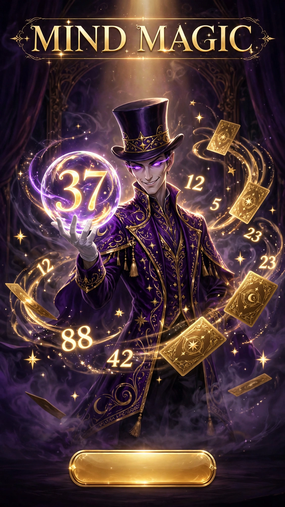
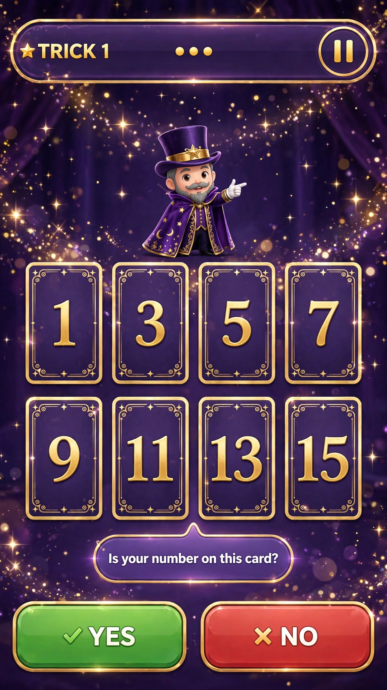

# MIND MAGIC — Magia Matemática para impresionar · Estudio + Plan

**Para:** Daniel · **De:** Niky (estudio de idea urgente) · **Fecha:** 15/11/2026, 21:32 (hora de Madrid)
**Estado:** solo estudio, mockup y plan. **Nada se fabrica.** Daniel aprueba antes el concepto y el mockup (puerta de producción). Si no responde en 10 min, la fábrica continúa según su regla — pero la versión final siempre pasa por él.

---

## 1. VEREDICTO: SÍ, ES POSIBLE DE VERDAD — 29/35 · 🟢 FUERTE

**El juego es de ADIVINAR y de TRUCOS MENTALES: el jugador piensa un número, una carta o un personaje, el juego le hace unas preguntas o unas operaciones y TE LEE LA MENTE adivinándolo. El momento estrella es LA REVELACIÓN.**

**Veredicto honesto: SÍ se puede hacer de verdad.** Hay **5 trucos que funcionan el 100 % de las veces** cuando el jugador sigue los pasos, con su prueba matemática en la sección 2. Ninguno finge la revelación, ninguno es una respuesta prefijada, ninguno se rompe si el jugador juega limpio. **Si no hubiera ni un truco que funcionara de verdad, el juego se cancelaba — pero los hay, así que no se cancela.**

**Condición escrita (sin ella, no es FUERTE):** el juego sale con **al menos 4 trucos reales distintos** (nunca uno solo), **nunca se explica el secreto** dentro del juego, y cada truco pasa el test del 100 % antes de entrar. Si un truco puede fallar, queda fuera.

**Título EN:** MIND MAGIC · **Título ES:** Magia Mental · **Slug:** `mind-magic` · **Género:** Brain & Puzzle / adivinar (estilo Akinator, pero con matemática de verdad). **PEGI 3. No es contenido para niños.**

---

## 2. LA REGLA DURA: SOLO TRUCOS QUE FUNCIONAN AL 100 %

Orden de Daniel (15/11 21:32): el juego tiene que funcionar de verdad — nada de trucos baratos, si no SE CANCELA. Estos son los trucos que pasan, con su prueba:

### Truco 1 — Las cartas binarias (adivinar el número, 1–63) ✅ 100 %
**Cómo se juega:** piensas un número del 1 al 63. El juego te enseña 6 cartas, una a una. En cada una tocas SÍ o NO: «¿Está tu número en esta carta?». Al final, el mago revela tu número.
**Prueba:** todo número n entre 1 y 63 tiene una única escritura en binario, n = b₀·1 + b₁·2 + b₂·4 + b₃·8 + b₄·16 + b₅·32. La carta i lleva exactamente los números con bᵢ = 1. Sumar 2ⁱ por cada SÍ da exactamente n. **Siempre.**
**Condiciones y límites:** el jugador tiene que contestar con sinceridad (si miente, el número sale mal — culpa suya, y el juego le dice «responde en serio» y repite). El jugador no hace ninguna cuenta: solo toca SÍ/NO. **6 toques, un dedo, ~15 segundos.** Primer nivel en 1–15 (4 cartas, 4 toques, ~10 s); luego 1–31 (5) y 1–63 (6).
**Por qué es el truco nº 1:** cero cuentas, cero errores posibles del jugador salvo mentir, y es el más visual para el Short.

### Truco 2 — El truco de las 21 cartas (adivinar la carta pensada) ✅ 100 %
**Cómo se juega:** piensas una carta de 21 que ves en la mesa, en 3 columnas de 7. El juego te pregunta 3 veces en qué columna está tu carta (tocas la columna). Al final, el mago saca tu carta.
**Prueba:** tras la 1.ª ronda tu carta queda entre las 7 del medio (posiciones 8–14 de 21); tras la 2.ª, entre las 3 del medio; tras la 3.ª, queda exactamente en la posición 11. **Siempre, es el truco clásico de las 21 cartas.**
**Condiciones y límites:** el jugador tiene que acordarse de su carta y señalar bien la columna (3 toques). Si señala mal, falla — el juego lo detecta (la carta no puede estar donde dice) y le pide que se fije bien y repita. Muy visual, muy de juego.
**Por qué es el nº 2:** 3 toques, cartas reales en pantalla, la revelación es sacar la carta física de la baraja.

### Truco 3 — El 1089 (adivinar el resultado, siempre 1089) ✅ 100 %
**Cómo se juega:** el mago escribe una predicción en un sobre cerrado ANTES de empezar. Piensas un número de 3 cifras con la primera y la última distintas (el juego no te deja ponerlas iguales). Lo das la vuelta, restas el menor del mayor, das la vuelta al resultado y lo sumas. El sobre se abre: **1089**.
**Prueba:** número 100a+10b+c con a≠c. Al revés: 100c+10b+a. Resta: 99(a−c) = 99d. 99d = 100(d−1)+90+(10−d). Al revés: 100(10−d)+90+(d−1). Suma: 900+180+9 = **1089. Siempre.**
**Condiciones y límites:** la primera y la última cifra tienen que ser distintas — el juego lo impone en la pantalla (no deja elegirlas iguales). El jugador hace las cuentas guiado paso a paso, con números grandes en pantalla; el juego calcula cada paso a partir del número que el jugador mete, así que no hay error de cuentas posible. La predicción es real porque 1089 sale con CUALQUIER número válido — el juego no necesita saber tu número para predecirlo.
**Por qué es el nº 3:** el sobre cerrado es el momento más mágico del juego (la predicción antes de empezar). Perfecto para el Short.

### Truco 4 — La bola de cristal (el símbolo forzado, múltiplos de 9) ✅ 100 %
**Cómo se juega:** piensas un número de 2 cifras, le restas la suma de sus cifras y miras el símbolo que hay junto a tu resultado en la tabla. Tocas la bola de cristal: sale tu símbolo.
**Prueba:** número 10a+b; restar (a+b) da 9a. **Siempre un múltiplo de 9** (9, 18, 27, 36, 45, 54, 63, 72, 81). Todos los múltiplos de 9 llevan EL MISMO símbolo en la tabla. **Siempre.**
**Condiciones y límites:** el jugador resta bien (2 cifras menos 1 cifra, fácil) y el juego guía el paso; si mete mal el resultado, la bola le dice que repita el paso. Los símbolos de la tabla se barajan en cada partida (los múltiplos de 9 siguen compartiendo uno), así que repetir no delata el truco.
**Por qué es el nº 4:** cero preguntas, un solo gesto (tocar la bola), la revelación más rápida del juego (~10 s).

### Truco 5 — El genio de los personajes (Akinator con conjunto cerrado) ✅ 100 %
**Cómo se juega:** piensas uno de los 16 personajes que ves en pantalla. El genio te hace 4 preguntas de SÍ/NO y te dice en quién pensabas.
**Prueba:** 2⁴ = 16. Cada pregunta parte el grupo por la mitad; 4 preguntas identifican a uno de 16. **Siempre, dentro del conjunto cerrado.**
**Condiciones y límites:** el personaje tiene que estar entre los 16 que se ven (el jugador elige de la lista). Es el truco con menos «wow» de los cinco — el jugador sabe que solo había 16 — pero es 100 % real y es el homenaje a Akinator que se puede hacer sin base de datos. Nivel avanzado, no el primero.

---

## 3. LOS TRUCOS QUE QUEDAN FUERA (y por qué)

| Truco | Por qué queda FUERA |
|---|---|
| **Akinator abierto** (piensa CUALQUIER personaje, el genio lo adivina) | **Puede fallar.** Necesita una base de datos enorme y un árbol de decisión entrenado; no cabe en un Jugable (bundle <15 MiB, sin internet) y si no conoce al personaje, la revelación es un fallo en la cara del jugador. Es el único truco de la lista que no es 100 %. FUERA. |
| **El cumpleaños adivinado** (mes ×2 +5 ×50 + día −250 = MMDD) | La matemática es 100 % real, pero **pide la fecha de nacimiento** — dato personal — y el juego es PEGI 3. No se le pide la fecha de nacimiento a un niño. FUERA por privacidad, no por matemática. |
| **Los trucos virales forzados** (te enseño 3 números rápido, todos llevan a «Pasta»; te enseño la carta 3 más tiempo y «adivino» el zorro) | **Amañados.** Funcionan solo si el jugador elige lo que el creador quiere. Los comentarios de esos vídeos lo dicen: «fake», «cheating», «me salió otro». Es exactamente lo que prohíbe la regla dura. FUERA. |
| **Cualquier respuesta prefijada** (el juego «adivina» lo que ya sabía porque se lo metiste antes, o porque siempre dice lo mismo) | No es magia, es mentirle al jugador. Si el jugador lo descubre — y lo descubrirá — el juego es una estafa. FUERA. |
| **Trucos con cuentas mentales difíciles sin verificar** (multiplicar por 50 de cabeza, restas largas) | La matemática es real pero el jugador se equivoca y el truco «falla» sin ser culpa del truco. Solo entran si el juego guía y verifica cada paso (como el 1089 y la bola). |

**Regla para siempre:** si un truco nuevo no pasa la pregunta «¿acierta el 100 % de las veces con el jugador jugando limpio?», no entra. El test se hace con 10 partidas de prueba por truco antes de aceptarlo.

---

## 4. PUNTUACIÓN: 29/35 · 🟢 FUERTE

Mismos 7 criterios de la lista de ideas (1–5 cada uno):

| Criterio | Puntos | Razón |
|---|---|---|
| Tendencia | 4 | Brain & Puzzle = 1,3B plays, ~22 % de YouTube Jugables (TubeGames 15/11). Akinator: 330 millones de instalaciones (AppBrain, datos 10/11/2026), 47.000 al día, 4,7 estrellas — el formato «leer la mente» está probadísimo. No es 5 porque la magia es un nicho dentro de Brain & Puzzle, no el subgénero nº 1. |
| Competencia | 4 | Akinator es una app (no está en Jugables) y las apps «Mind Reader» de Google Play son feas y planas (la de las cartas binarias 1–63 es literalmente el Truco 1, sin arte ni show). En Jugables no hay un lector de mentes top. Nos diferenciamos con arte premium + 5 trucos reales + la revelación como espectáculo. No es 5 porque la mecánica binaria es pública y copiable; la ventaja es la ejecución. |
| Viabilidad | 5 | Mecánicas triviales de programar (toques SÍ/NO, 3 toques de columna, cuentas guiadas). Arte premium primero: un mago, una bola, cartas. Un ciclo sin problema, sobre la plantilla. |
| Potencial viral | 5 | **La revelación ES el Short.** La cara del jugador cuando el juego acierta su número o su carta es el momento más grabable de toda la lista. Los trucos mentales falsos de Instagram sacan 78K–97K likes (Raphie, 2026) — y los comentarios los llaman falsos. Uno REAL es más fuerte. |
| Se entiende en 3 s | 4 | «Piensa un número, te lo adivino» se pilla al instante, sin leer. No es 5 porque el primer truco necesita que el jugador entienda el flujo SÍ/NO (un toque para aprenderlo). |
| Adicción | 3 | **El punto débil, honesto.** Cuando sabes el truco, la sorpresa se acaba. Mitigación: 5 trucos distintos, reto diario (un truco nuevo cada día), «reta al mago» (intenta pillarlo), colección de trucos, rangos cada vez mayores (1–15 → 1–31 → 1–63). Y el juego NUNCA explica el secreto. Aun así, la rejugabilidad es menor que en Traffic Chaos: 3, no más. |
| Monetización | 4 | Intersticial en la pausa natural tras la revelación (nunca a mitad de truco) + rewarded opt-in para desbloquear un truco nuevo o un «segundo intento». Reparto según la FAQ oficial de Playgama (pendiente de reconciliar el 75/25 con el doc del kit). |
| **TOTAL** | **29** | **FUERTE — mismo nivel que Apila la Pizza y Limonada Exprés (29).** |

**Veredicto:** FUERTE. Merece concepto + mockup. La condición escrita de la sección 1 (≥4 trucos, nunca explicar el secreto, test del 100 %) es obligatoria: con un solo truco, esta idea sería DUDOSA.

---

## 5. DISEÑO: CÓMO SE VERÍA

**Dirección de arte:** mago misterioso de escenario — terciopelo morado y oro, bola de cristal, cartas doradas flotando, números dorados en el aire, foco de teatro sobre fondo morado oscuro. El mago es el personaje: elegante, con chistera, ojos violetas, sonrisa de «ya lo sé». La revelación es el primer fotograma: el número dentro de la bola de cristal.

### Mockup (diseño acabado, 9:16)

El mago con la bola de cristal (el 37 dentro), cartas y números dorados flotando, título MIND MAGIC en oro, botón dorado abajo. Este es el diseño que Daniel aprueba o cambia.

### Preview de trabajo (cómo se juega, HUD real)

Truco 1 en marcha: HUD con «TRICK 1», 3 puntos de progreso y pausa; el mago señala; la carta con los números 1–15; la pregunta «Is your number on this card?»; botones enormes YES (verde) y NO (rojo). La preview es referencia de estilo, no un fotograma literal: el juego real adapta el estilo a la jugabilidad.

**Desviaciones honestas de las imágenes (a corregir al construir):**
- Los dos magos NO coinciden: el del mockup es un mago elegante y joven; el de la preview es un mago mayor, estilo chibi, con barba gris. **El juego lleva UN solo mago.** El mockup marca la dirección (elegante); la preview marca la jugabilidad. Daniel elige cuál, o se unifica en el elegante del mockup.
- El botón dorado del mockup salió sin texto: en el juego real lleva «READ MY MIND» / «LEE MI MENTE».
- La preview muestra la carta 1–15 correcta (1, 3, 5, 7, 9, 11, 13, 15 — los impares, carta del 2⁰). Las demás cartas del truco siguen la misma regla binaria.

---

## 6. EL JUEGO: CONCEPTO Y MECÁNICA PASO A PASO

**Concepto en una frase:** eres el público de un mago que te lee la mente de verdad — piensas un número, una carta o un personaje, y él lo adivina delante de ti, sin fallar nunca.

**Flujo de cada truco (igual en los 5, 10–20 segundos por truco):**
1. **La predicción (opcional, trucos 3 y 4):** el mago escribe su predicción en un sobre cerrado ANTES de empezar. Es la prueba de que no hace trampas.
2. **Piensa:** «Piensa un número del 1 al 15» (o una carta, o un personaje). Sin escribir nada, sin contárselo a nadie.
3. **Las preguntas:** toques SÍ/NO, o tocas una columna, o sigues las cuentas guiadas. Un dedo, botones enormes (≥88 px).
4. **La revelación:** la bola se ilumina, las cartas vuelan, el número aparece dentro de la bola con confeti dorado y el mago sonríe: «¡Tu número es el 37!». Es el momento estrella — con juice en cada revelación (cámara lenta, brillo, sonido).
5. **¿Otra vez?:** «¿Te lo adivino otra vez?» — siguiente truco, o el mismo con otro número. Reto diario: un truco nuevo cada día.

**Los 5 trucos como niveles (en orden):**
| Nivel | Truco | Toques | Segundos |
|---|---|---|---|
| 1 | La bola de cristal (múltiplos de 9) | 1 (tocar la bola) | ~10 |
| 2 | Las cartas binarias 1–15 (4 cartas) | 4 (SÍ/NO) | ~10 |
| 3 | Las 21 cartas (la carta pensada) | 3 (columna) | ~15 |
| 4 | El 1089 (el sobre cerrado) | 1 número + pasos guiados | ~20 |
| 5 | El genio de los 16 personajes | 4 (SÍ/NO) | ~15 |

**Después del nivel 5:** rangos mayores (1–31, 1–63), reto diario, «reta al mago» (elige tu propio número grande y reta al mago a adivinarlo con las cartas), colección de trucos desbloqueables (rewarded opt-in para desbloquear un truco nuevo).

**Meta visible desde el día 1:** «Maestro de la mente» — completa los 5 trucos y desbloquea el truco secreto del día. Sesión 3–8 min, niveles de 10–20 s, reintento en un toque, cero texto en el onboarding (el mago señala, tú tocas).

**Monetización:** intersticial tras la revelación (pausa natural, nunca a mitad de truco, nunca en el nivel 1); rewarded opt-in para desbloquear un truco o un segundo intento. Sin anuncios en la primera sesión.

**Short (el momento para grabar):** la revelación del Truco 1 o del 1089 — el número aparece en la bola y el jugador reacciona. 8–10 s, acaba en la revelación.

---

## 7. SKILLS: QUÉ CONSTRUYE CADA PARTE

Revisadas las 147 del kit (66 de Grok + 81 nuevas, PR #27) + 13 de oficina + 10 de SpriteCook. Selección para este juego (SpriteCook NO se usa: decisión de Daniel 21:03, skills gratis del kit, sin cuenta ni pago):

| Parte | Skills |
|---|---|
| Dirección de arte (mago, bola, cartas, morado/oro) | `art-bible` (identidad visual), `directing-game-visuals` (dirección), `game-ui-taste` (UI con identidad, nada genérica), `create-game-assets` |
| Mago, cartas, bola, efectos | `generate2dsprite` (mago y props), `sprite-atlas` (empaquetado), `vfx-generate` (brillo de la revelación), `pixel-animation` (si se pide versión pixel), `spine-skeletal` (animación del mago) |
| UI/HUD (botones YES/NO, HUD, pausa) | `game-ui-ux-pro-max` (botones ≥88 px, hitArea centro + 4 esquinas), `mobile-native` (táctil), `gating-intent-legibility` (que se entienda en 3 s) |
| Mecánica (los 5 trucos, 100 % de acierto) | `puzzle` (diseño de puzle), `implementing-gameplay-invariants` (la invariante: el truco acierta siempre), `designing-minimal-game-rules` (reglas mínimas), `balance-design` (dificultad por niveles) |
| Feel de la revelación | `maximizing-game-feel`, `action-feel`, `juice-vfx` (la revelación con cámara lenta y brillo), `audio-feel` (sonido de la revelación), `haptic-rumble` (vibración al revelar) |
| Prototipo desechable | `prototype-fast` (probar que los 5 trucos se entienden en 10 s antes de programar el juego) |
| Plataforma (Playgama + YouTube Jugables) | Plantilla (PR #4) + skills de Playables; `certification-checklist`; `performance-budget` (bundle <15 MiB, <5 s) |
| Marketing (Short de la revelación) | `hook-writer` (el gancho de 0–3 s), `thumbnail-design` (la bola con el número), `virality`, `playgama-game-video` |
| Calidad (gate) | `asset-audit`, `review-game`, `game-quality-gates`; `game-playtest-squad-skill` (PENDIENTE de licencia — prioridad nº 1, pedirla al autor, 0 € si la concede) |

---

## 8. PLAN: QUÉ FALTA PARA FABRICARLO

**Hecho en este estudio:** viabilidad probada con matemática (sección 2), puntuación 29/35, mockup, preview de trabajo, plan completo, skills seleccionadas.

**Pendiente (en orden, según las 14 obligaciones):**
1. **Daniel aprueba el concepto y el mockup** (esta entrega). Si no responde en 10 min, la fábrica continúa según su regla — pero la versión final siempre pasa por él.
2. Teardown del género (≥3 puntos para superar al mejor: Akinator y las apps Mind Reader — datos reales con fuente).
3. Preview EXACTA desde dentro jugando (HUD real, partida en marcha) como guía visual antes de producir.
4. Prototipo desechable: los 5 trucos jugables en 10 s cada uno, con 10 partidas de prueba por truco (test del 100 %).
5. Arte premium primero, fiel al mockup: UN solo mago (elegir entre el elegante del mockup y el chibi de la preview), bola, cartas, fondos, UI, efectos, audio — completo, sin saltarse nada.
6. Código con la plantilla (Phaser 3 + TS + Vite, Bridge + ytgame, juice en la revelación, guardado solo con bridge.storage, intersticial en pausa natural, rewarded opt-in, botones ≥88 px, hitArea con test centro + 4 esquinas + toque fuera).
7. Playtest humano 3 de 3 (¿entienden cómo jugar en 10 s? ¿la revelación impresiona?).
8. QA técnica (0 defectos táctiles, <5 s, <15 MiB, 60 FPS, 0 errores, zip ≤5 MB, portadas con sello, listing EN+ES, capturas 390×844, GIF 8–10 s que acaba en la revelación).
9. Daniel prueba la versión final — sin su visto bueno no se publica.
10. Publicar en Playgama / YouTube Jugables (EN primero, PEGI 3, no niños, original — nunca copiar a Akinator, solo orgánico). **Pendiente verificar que el título MIND MAGIC está libre en Playgama antes de construir.**
11. Short + marketing (la revelación, 8–10 s).
12. Métricas y siguiente juego (la fábrica no se para).

**Riesgos honestos (para que Daniel los sepa antes de aprobar):**
- **La rejugabilidad (Adicción 3):** cuando el jugador descubre el truco, la magia se acaba. La defensa es la variedad (5 trucos), el reto diario y no explicar jamás el secreto. Si el juego sale con un solo truco, fracasa.
- **El jugador que miente:** si contesta NO cuando es SÍ en las cartas, el número sale mal. El juego tiene que detectarlo («eso no cuadra, ¿estás seguro?») y repetir sin acusar.
- **El jugador que se cree el truco:** algunos jugadores buscarán el secreto en internet (las cartas binarias están en Wikipedia). No pasa nada: el juego es el show, no el secreto. Pero nunca se explica dentro del juego.
- **Akinator es la referencia y el techo:** 330M de instalaciones. No le ganamos en base de datos (no la tenemos ni la queremos); le ganamos en que nuestros trucos son matemática pura y funcionan sin internet, en 10 segundos, dentro de YouTube.

---

**Fuentes (verificadas 15/11/2026):** Akinator 330M instalaciones, 47K/día, 4,7★ (AppBrain, datos 10/11/2026; Google Play 100M+); Brain & Puzzle 1,3B plays, ~22 % de Jugables (TubeGames, informe de demanda 15/11); «Mind Reader» 1–63 con 6 cartas (Google Play); trucos mentales virales 78K–97K likes con comentarios de «fake» (Instagram, Raphie 2026); pruebas matemáticas propias (sección 2).
